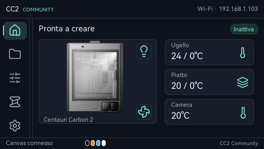
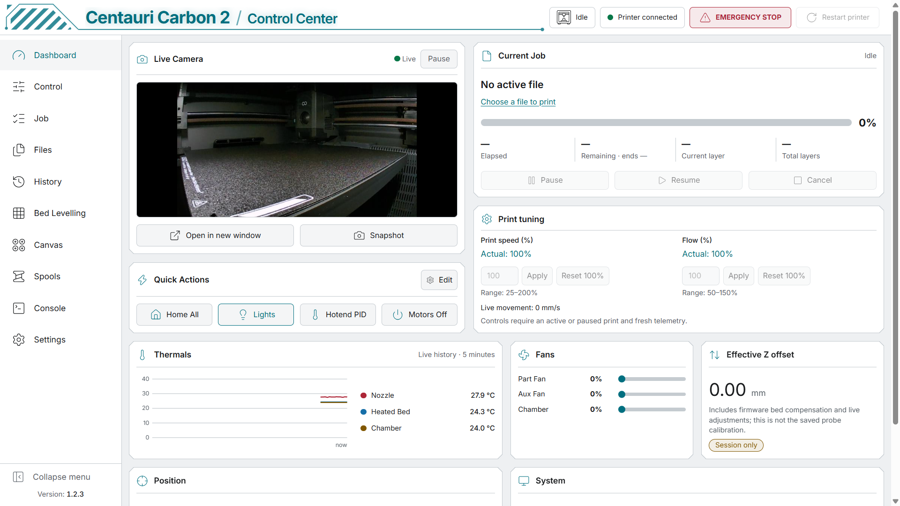
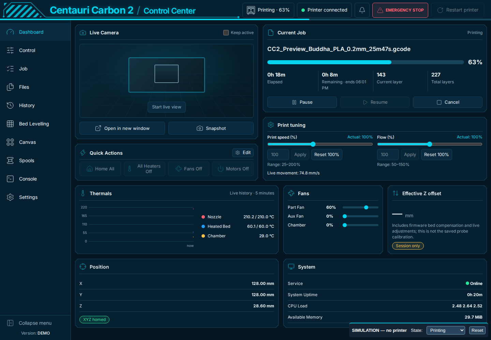
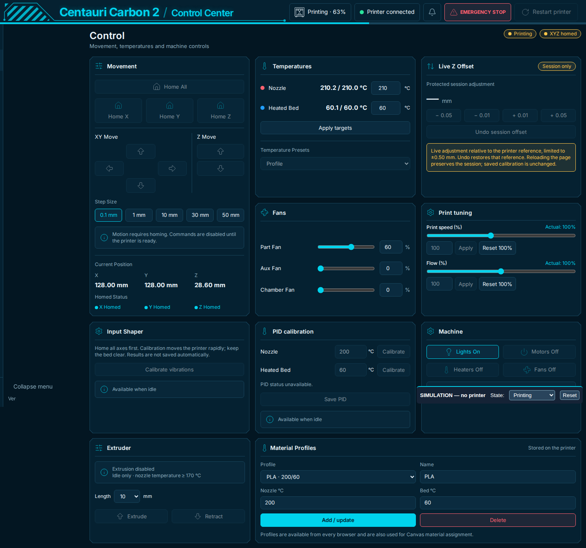
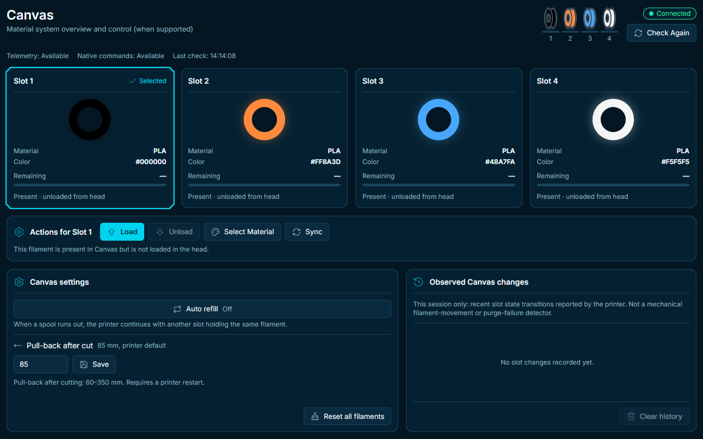
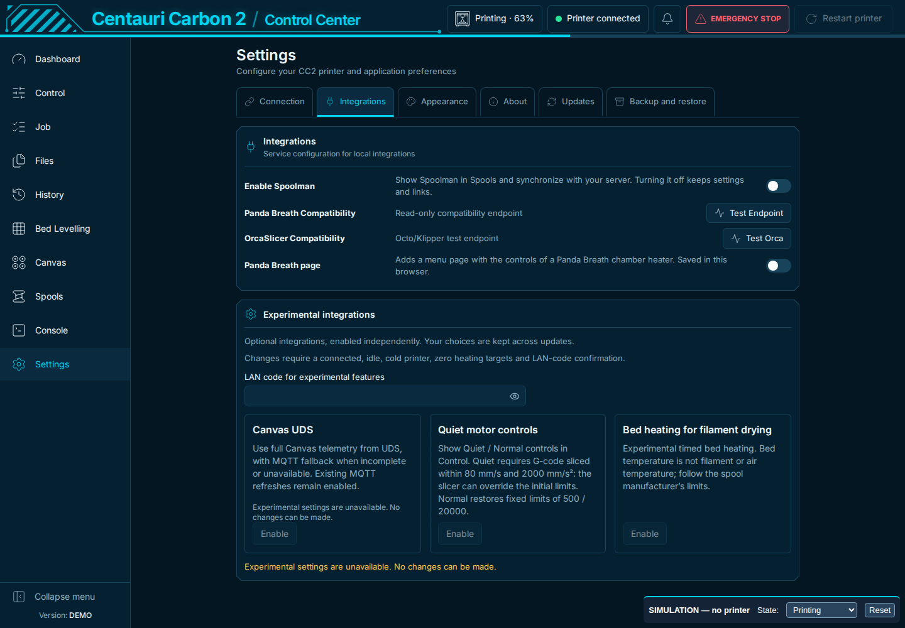

# Centauri Carbon 2 Community Firmware

Community firmware, local printer control and reproducible build tools for the
**ELEGOO Centauri Carbon 2**, maintained by **Neme77**.

> **NEW: NATIVE DISPLAY V4.4.3 + CC2 CONTROL 1.2.25.** Native Obsidian/cyan touchscreen, exhaust flaps, Pressure Advance, Rotation Distance, load-cell tools, experimental nozzle expansion/chamber preheat, optional qualified RTL8153 Ethernet and update recovery. [Download and complete notes](https://github.com/Neme77/centauri-carbon-2-community/releases/tag/CC2-Control-1.2.25-V4.4).

  
  &nbsp;
  

| **🖨️ Complete firmware · V4.4.3** | **🔄 CC2 Control · 1.2.25** |
| --- | --- |
| [**Download signed firmware**](https://github.com/Neme77/centauri-carbon-2-community/releases/download/V4.4.3/CC2_V4_4_3_STOCK_Control_1_2_25.zip.sig) · [Release notes and checksums](https://github.com/Neme77/centauri-carbon-2-community/releases/tag/V4.4.3) | [**Download Windows / macOS / Linux package**](https://github.com/Neme77/centauri-carbon-2-community/releases/download/CC2-Control-1.2.25-V4.4/CC2-Control-1.2.25-Multiplatform-Update.zip) · [Release notes and checksums](https://github.com/Neme77/centauri-carbon-2-community/releases/tag/CC2-Control-1.2.25-V4.4) |
| Complete installation with Control **1.2.25**, the native display refresh, optional Ethernet components and existing webcam/reactor fixes. Allow the installation reboot and Canvas synchronization to finish. | For community firmware **V4.4/V4.4.1/V4.4.2/V4.4.3**. Cumulative app update; does not replace the native display. |

## New in CC2 Control 1.2.25 and firmware V4.4.3

The application update includes the controls and calibration tools below. The **native touchscreen refresh** is included in **full firmware V4.4.3**.

- **Exhaust flaps:** explicit **Open / Close** buttons beside the EXHAUST fan, using the native firmware commands and existing operation guards. Also available as configurable Quick Actions.
- **Pressure Advance:** read, apply temporarily or disable the active native value alongside speed and flow. Start G-code can override it; applying does not silently save configuration or change smooth time.
- **Load-cell tools:** native **read, diagnostics, tare and guided known-mass calibration**, with explicit measurement, acceptance, verified saving and protected restart. No automatic heating or motion is started.
- **Rotation Distance:** read active/configured/saved values, calculate from a physical extrusion measurement, apply temporarily, restore the configured reference and save with verification. Other PID, mesh, gear-ratio and offset settings are preserved.
- **Configurable Quick Actions:** four slots retain existing choices and gain Open/Close flaps and navigation to Connections, Fans, Pressure Advance and bed/chamber heating. Opening a page does not activate heating or a calibration.
- **Experimental nozzle thermal-expansion calibration:** native temperature-range calibration, validated results and a way back to the factory table; by **@Noahwhite2014** (#273). Enable it separately under Settings → Integrations.
- **Experimental chamber preheat:** an additional bed-heating mode with closed exhaust grille, tapered auxiliary circulation, ready/hold reporting, reachability estimate and print hand-off. Requested by **@Sceletor** (#270), contributed by **@Noahwhite2014** (#277). Filament drying keeps its separate limits; this does not add an active chamber heater.
- **Native display redesign:** Obsidian/cyan styling across the original sections, refreshed Home and icons, CC2 Community boot artwork with animated loading bar, native language support and inline read-only LAN information. Original ELEGOO printer/Canvas artwork and native functions are retained. **Full firmware V4.4.3 only** (#282).
- **USB Ethernet and hubs:** corrected RTL8153 interface-parent recognition behind USB hubs. TP-Link UE300 `0bda:8153` revision `31fd` is physically qualified; revision `3000` requires explicit experimental opt-in (#274, reported by **@kalross**, #278). Other IDs/revisions are not automatically qualified. Full firmware ships the reviewed modules; the stock kernel is unchanged and Ethernet remains opt-in.
- **Recovery after a supported base-firmware reinstall:** recognize the exact retained Connections installation, restore its hooks with backups and preserve confirmed settings. Unknown edits remain refused.
- **Installation and cleanup:** computer-assisted installers stage payloads on persistent disk rather than RAM-backed `/tmp`, check available disk/RAM before transfer and before parsing embedded components, verify archives, retain failed attempts/logs and clean input payloads only after success. Fixes the installation-time OOM reproduced and verified by **@Neme77**.
- **Calibration and UI fixes:** save plate measurements only after the current native mesh run positively completes (#279, reported by **@Noahwhite2014**); continuous Obsidian gradients on Appearance/About; clear bed-drying/chamber-preheat text in all nine UI languages; hide a superseded completed updater selection after a firmware upgrade.
- **Existing stability fixes retained:** reactor callback integration, webcam R2 client-thread reclamation and readiness recovery, direct emergency stop, pending SAVE_CONFIG protection, Canvas/material tools, Spoolman and previous cumulative improvements.

The native maintenance tools and display were developed and physically tested by **@Neme77** (#282, #283, #286, #287). Thanks to **@Surfoo, @beanbo, @tharje, @pezso92**, all contributors/translators and **DamiBFryta, our ultimate beta tester**. [Complete original attribution](docs/CONTRIBUTORS.md).

**During Ethernet driver installation/activation, Canvas LEDs may briefly flash red while native services realign, then return to operation. Wait for Canvas to reconnect and follow every complete idle-printer reboot request before printing.** Experimental features remain off until explicitly enabled.

[**Windows / Linux / macOS application installer**](https://github.com/Neme77/centauri-carbon-2-community/releases/download/CC2-Control-1.2.25-V4.4/CC2-Control-1.2.25-Multiplatform-Update.zip) · [**Signed panel update**](https://github.com/Neme77/centauri-carbon-2-community/releases/download/CC2-Control-1.2.25-V4.4/CC2-Control-1.2.25-V4.4.cc2update) · [**Complete application release notes**](https://github.com/Neme77/centauri-carbon-2-community/releases/tag/CC2-Control-1.2.25-V4.4) · [**Complete firmware and native display**](https://github.com/Neme77/centauri-carbon-2-community/releases/tag/V4.4.3)

## Native display preview

Actual 532 × 300 printer capture. Native functions and ELEGOO printer/Canvas artwork are retained; the example uses Italian. The display refresh is included in full firmware V4.4.3. Both release pages list features, contributor credits, adapter qualification and installation details.

> **Optional experiment · Canvas pull-back R4:** [**Download the Windows / Linux / macOS kit**](https://github.com/Neme77/centauri-carbon-2-community/releases/download/CC2-Control-1.2.22-V4.4/CC2-Canvas-Pullback-Experimental-R4.zip). Extends the configurable limit up to 1000 mm on qualified **V4.4.1/V4.4.2** with Control **1.2.21/1.2.22**. By **Noahwhite2014**. [Instructions](experimental/canvas-pullback-kit/README.en.md). Remove the component and reboot before app/firmware updates.

**Updating from the CC2 Control panel?** [Download the signed `.cc2update` file](https://github.com/Neme77/centauri-carbon-2-community/releases/download/CC2-Control-1.2.25-V4.4/CC2-Control-1.2.25-V4.4.cc2update) and select it in **Settings → Updates**. Follow every complete idle-printer reboot request, including component activation or recovery after a base-firmware reinstall. Canvas LEDs may briefly flash red during Ethernet activation while native services realign; wait for Canvas to reconnect before printing.

[Documentation](docs/README.md) · [Downloads](https://github.com/Neme77/centauri-carbon-2-community/releases) · [Screenshots](docs/SCREENSHOTS.md)

> Independent community project, not affiliated with or supported by ELEGOO.
> This project targets the **Centauri Carbon 2**, not the first Centauri Carbon.

  

## Get started

| What you need | Guide |
| --- | --- |
| Install the complete community firmware | [First installation](docs/FIRST_RUN.md) |
| Update an existing CC2 Control installation | [Application updates](docs/UPDATE_CC2.md) |
| Connect OrcaSlicer and synchronize Canvas slots | [OrcaSlicer setup](docs/ORCASLICER.md) |

Download files from [GitHub Releases](https://github.com/Neme77/centauri-carbon-2-community/releases)
and follow the matching guide and release notes. **Complete firmware**, the
**CC2 Control application** and the **source builder** are different downloads:
the builder ZIP is not an installable printer update. Check the supplied SHA-256
checksums before installation.

The current qualified firmware family is **V4.4/V4.4.1/V4.4.2/V4.4.3**, based on ELEGOO
**02.01.01.07**. Its application updates are not interchangeable with stock
firmware, older community firmware or experimental builds.

Open **`http://PRINTER-IP:8081`** on your local network. OrcaSlicer also needs
**`:8081`** after the printer IP. App installation requires the printer’s **LAN
access code**, which is different from the SSH password; checking for updates
does not. Installation always requires confirmation. Camera-component updates
require a **full printer reboot** as described in their release notes.

## What CC2 Control offers

- Local dashboard, live video, temperatures, fans, print speed and flow controls.
- Internal/USB files, model previews and interactive object exclusion.
- Canvas slot states, material settings, auto refill and OrcaSlicer filament sync.
- Bed leveling, saved plate/nozzle meshes and optional spool inventory/tracking.
- Backup and selective restore, diagnostics, protected Console and signed app updates.
- Multiple interface languages, themes and desktop/mobile layouts.

See the [application guide](docs/CC2_CONTROL.md) and [screenshot gallery](docs/SCREENSHOTS.md).
Experimental features remain opt-in and require their own validation.

## Previously added in CC2 Control 1.2.24

- **Connections:** optional USB Ethernet alongside native Wi-Fi, saved Wi-Fi profiles, DHCP/static IPv4, manual connection selection, interface switches and Diagnostics. Wi-Fi remains available without an adapter; no automatic signal-quality switching.
- **Qualified adapter:** TP-Link UE300 / Realtek RTL8153, USB 0bda:8153 revision 31fd, on Community V4.4.2. Other products or revisions are not automatically qualified by sharing a chipset. Stock firmware is unsupported; Ethernet link rate is not a USB 2.0 transfer benchmark.
- **Obsidian and layout:** new theme, centered page widths, sidebar resize/collapsed-icon polish and stronger Canvas rings (#255, #257–#259, Neme77 and Surfoo).
- **Cumulative fixes:** direct emergency stop (#264/#265, Noahwhite2014 and maintainer review), long calibration bed keep-alive (#256, beanbo), guarded busy-file deletion (#259), localized refusals (#261/#262, pezso92 report), corrected Z arrows/calibration copy (#252–#254), and pending SAVE_CONFIG protection (#267, Noahwhite2014 report; Neme77 correction).

[Original 1.2.24 release and contributor credits](https://github.com/Neme77/centauri-carbon-2-community/releases/tag/CC2-Control-1.2.24-V4.4).

## New in CC2 Control 1.2.23

### **PRINT TPU WITHOUT DISCONNECTING CANVAS**

Enable **External spool with Canvas connected** under **Settings → Integrations → Experimental integrations**, then select External spool in Canvas or Control. It remains **EXPERIMENTAL, optional and off by default**. A direct external filament path is required: TPU does not run through Canvas. Native source selection keeps Canvas connected and communicating.

**DamiBFryta, our definitive beta tester, validated the full PLA → TPU cycle, including eSUN TPU 95A printing, without unplugging Canvas: no issues and no errors.** Neme77 validated external PLA loading/purge, a completed print and return to normal Canvas loading. Other flexible materials, hardness and paths need their own validation. Native loading/purge speeds are unchanged.

[External-feed instructions](https://github.com/Neme77/centauri-carbon-2-community/blob/main/cc2-control/docs/EXTERNAL_FEED_EXPERIMENT.md).

[**CC2 Control 1.2.23: download and complete release notes**](https://github.com/Neme77/centauri-carbon-2-community/releases/tag/CC2-Control-1.2.23-V4.4).

## New in CC2 Control 1.2.22

> **Corrected in 1.2.23:** the Updates text now correctly points to Settings → Integrations. Sorry for the earlier misleading wording.

- **External spool, including printers bought without the Canvas Combo:** native **Load / Unload** when Canvas is confirmed absent, plus **Brand → Type → Subcategory → Colour** editing. Canvas shares the stock material catalog and 24-colour palette (#233). External feeding with Canvas connected is available as an opt-in experiment starting in 1.2.23.
- **Dashboard:** pezso92’s paused-camera artwork, speed/flow sliders alongside numeric Apply/Reset controls, aligned panels and **Keep active** in the camera header (#223).
- **Control:** compact machine actions, live Z offset above print tuning and aligned calibration panels (#226).
- **Spoolman:** optional server sync by **tharje** (#208), independently enabled in Integrations; configuration and local tracking are kept when disabled (#227).
- **LAN code:** optional verified browser-local remembering, masked prefilled fields and explicit Forget (#225).
- **Print completion:** nonblocking filename/duration notice, Confirm and Print again; idle progress clears without homing (#219).
- **Spool history:** bounded scrolling with All / Consumption-only filters, suggested by **DamiBFryta** (#220).
- **Experimental integrations:** Canvas UDS, Quiet and timed bed heating grouped in Settings → Integrations, independently enabled with aligned actions (#223/#232).
- **Filament drying experiment:** finite timed bed heating, explicit stop and zero-target confirmation (#198/#218/#230); requested by **romeopuch**, native help-check issue diagnosed by **Noahwhite2014**, documentation clarified by **pezso92** (#235).
- **Updates and packaging:** supported-version notices corrected in all nine languages (#222); unused firmware web overlay removed (#229). Cumulative webcam fix, preferences, mesh libraries and backups retained.

### Optional extended Canvas pull-back

[**Separate experimental Windows / Linux / macOS kit**](https://github.com/Neme77/centauri-carbon-2-community/releases/download/CC2-Control-1.2.22-V4.4/CC2-Canvas-Pullback-Experimental-R4.zip), by **Noahwhite2014** (#228). Qualified **V4.4.1/V4.4.2 only**, with Control **1.2.21/1.2.22**. Raises the accepted range up to 1000 mm without choosing a distance or sending movement; suitability depends on the filament path. **Remove it and reboot before app/firmware updates.** Never installed by the automatic updater. [Instructions](experimental/canvas-pullback-kit/README.en.md).

Canvas layout inspired by **Surfoo**; original Quiet feature by **BorjaLL**. Experiments retain saved choices. Previews use simulated data. Full V4.4.3 includes Control 1.2.25 and the native touchscreen refresh; the separate app update retains the existing display.

[Release notes / Note complete, validation, checksums and credits](https://github.com/Neme77/centauri-carbon-2-community/releases/tag/CC2-Control-1.2.22-V4.4).

## Help and development

[Documentation index](docs/README.md) · [Report a problem](https://github.com/Neme77/centauri-carbon-2-community/issues) · [Contributing](CONTRIBUTING.md) · [Build guide](docs/BUILD.md) · [Source and provenance](docs/SOURCE.md)

Version history belongs in the [CHANGELOG](CHANGELOG.md) and
[release notes](https://github.com/Neme77/centauri-carbon-2-community/releases).
Installation details and compatibility requirements are maintained in the guides
linked above.

## Community

[**Join the Centauri Carbon 2 Community Firmware Discord**](https://discord.gg/FGfCaFpm38)
for community discussions, setup help, print experiences and feedback.
For reproducible bugs and feature requests, please keep using
[GitHub Issues](https://github.com/Neme77/centauri-carbon-2-community/issues)
so reports remain searchable and trackable.

Thanks to **Surfoo, beanbo, efiten, Skcycos, pezso92, asiersan, Noahwhite2014,
tharje, Nick Plateringen-Paul**, and every contributor, translator and tester.
Special thanks to **[DamiBFryta](https://www.reddit.com/user/DamiBFryta/), our
ultimate beta tester**. [Full credits and original contributions](docs/CONTRIBUTORS.md).

AI-assisted work is reviewed and validated. Architecture decisions, printer-side
testing and release approval remain with the maintainer and community testers.

## License

Project code is GPL-3.0-only where contributors have the right to license it.
Vendor firmware and third-party components retain their own terms.
See [LICENSE](LICENSE) and [NOTICE.md](NOTICE.md).
