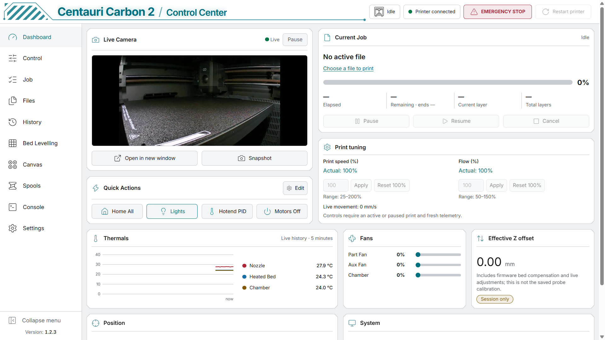
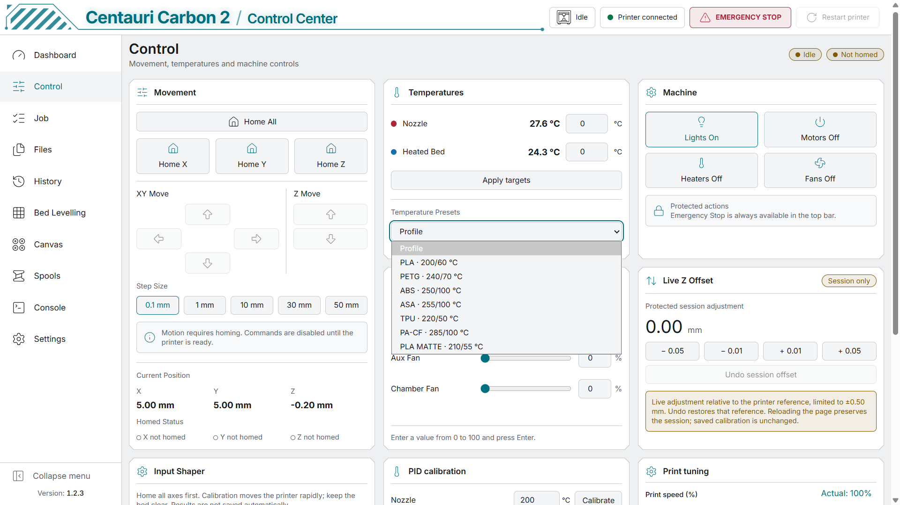
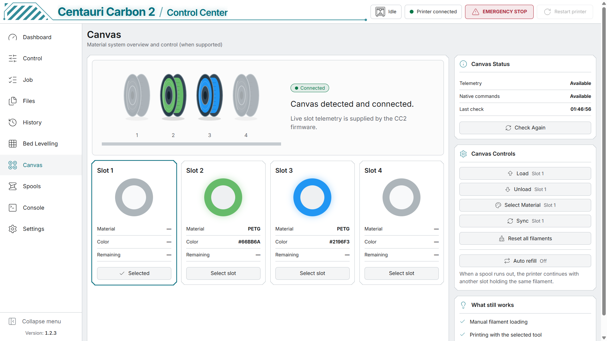
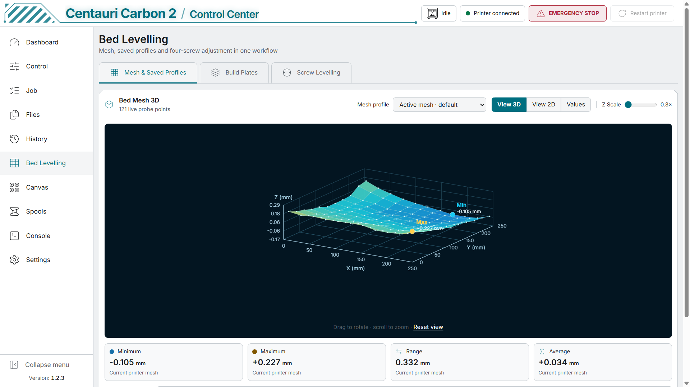
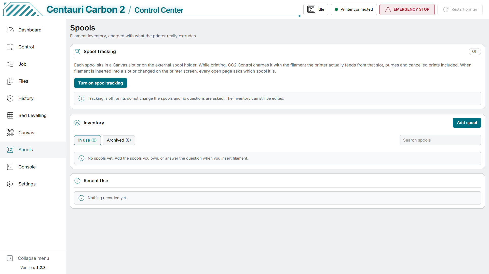

# Centauri Carbon 2 Community Firmware

Community firmware, local printer control and reproducible build tools for the **ELEGOO Centauri Carbon 2**, maintained by **Neme77**.

> Independent community project. Not affiliated with, endorsed by or supported
> by ELEGOO.

<strong>Local control · Canvas · OrcaSlicer sync · Nine app languages · Six themes</strong>

  <a href="docs/FIRST_RUN.md">First installation</a> · <a href="docs/ORCASLICER.md">OrcaSlicer &amp; Canvas</a> · <a href="docs/SCREENSHOTS.md">Screenshots</a> · <a href="docs/CONTRIBUTORS.md">Community credits</a>

  

## Start here / Guide rapide

| Guide | English | Italiano |
| --- | --- | --- |
| First installation, printer IP and LAN access code | [First setup](docs/FIRST_RUN.md) | [Prima installazione](docs/FIRST_RUN.it.md) |
| OrcaSlicer connection, upload and Canvas filament sync | [OrcaSlicer guide](docs/ORCASLICER.md) | [Guida OrcaSlicer](docs/ORCASLICER.it.md) |
| Camera freezes, MJPEG troubleshooting and safe checks | [Camera diagnostics](docs/CAMERA_DIAGNOSTICS.md) | [Guida (English)](docs/CAMERA_DIAGNOSTICS.md) |
| Latest complete firmware and retained features | [Changelog](CHANGELOG.md#community-firmware-v441--cc2-control-1210--2026-10-14) | [Novità della release](CHANGELOG.md#community-firmware-v441--cc2-control-1210--2026-10-14) |

## V4.4.1 — complete firmware with CC2 Control 1.2.10

**[Download the complete V4.4.1 firmware](https://github.com/Neme77/centauri-carbon-2-community/releases/tag/V4.4.1)** — released **14 October 2026**, on the qualified **ELEGOO CC2 02.01.01.07** base.

**For new users: one firmware installation includes CC2 Control 1.2.10, its qualified fixes and the complete signed updater in Settings.** No second application package from the computer is needed. The native callback and firmware patches remain included; Canvas stays on MQTT. PR103/114 and full experimental Canvas UDS remain excluded.

  
  
  

| Download | Purpose |
| --- | --- |
| [Complete signed V4.4.1 firmware](https://github.com/Neme77/centauri-carbon-2-community/releases/download/V4.4.1/CC2_V4_4_1_STOCK_20261014_205610_dd82af94.zip.sig) | Printer USB/offline installation; includes compatible base, CC2 Control 1.2.10 and updater helpers. Keep the `.zip.sig` intact. |
| [Public source builder](https://github.com/Neme77/centauri-carbon-2-community/releases/download/V4.4.1/CC2-Builder-V4.4.1-Source.zip) | Source-only computer build kit; official vendor inputs, qualified tools and private signing/AES keys remain external. This ZIP is not printer firmware. |
| [SHA256SUMS.txt](https://github.com/Neme77/centauri-carbon-2-community/releases/download/V4.4.1/SHA256SUMS.txt) | Checksums for these exact release assets. |

[First installation in English](docs/FIRST_RUN.md) · [Prima installazione in italiano](docs/FIRST_RUN.it.md). Existing V4.4 users may instead install the application-only update below; a factory reset is not required. Keep the existing V4.4-compatible application channel: **4.4.1 is the complete firmware release, while 4.4 is its compatibility family**. The printer display retains base 02.01.01.07.

**Application update authorization:** Check for updates needs no LAN code. Download/upload and Install require confirmation with the printer's configured LAN code, read on the display under **Settings → LAN only**, even when CC2 Control is already connected. This is different from the SSH password. [English explanation](docs/UPDATE_CC2.md#why-the-lan-code-is-required) · [Spiegazione italiana](docs/UPDATE_CC2.it.md#perché-viene-richiesto-il-codice-lan). Updates are never installed unattended; the panel updates CC2 Control, while complete firmware uses the USB procedure.

The exact R3 image passed its signed build and maintainer installation/connection/Canvas/profile-retention/restart trial. All seven CI jobs passed. Earlier prolonged-print beta reports remain described below; they are not a new 40-hour test of this exact image. Integration: [PR126](https://github.com/Neme77/centauri-carbon-2-community/pull/126); application PRs and contributors are credited below.

**Italiano:** la V4.4.1 offre ai nuovi utenti un unico firmware con CC2 Control 1.2.10, fix e updater già integrati. Per gli update successivi basta il pannello e la conferma con il codice LAN. Chi usa già la V4.4 può scegliere l'aggiornamento della sola applicazione. Non serve ripristinare la stampante.

## CC2 Control 1.2.18 — Canvas and Panda Breath

**[Download CC2 Control 1.2.18](https://github.com/Neme77/centauri-carbon-2-community/releases/tag/CC2-Control-1.2.18-V4.4)** · [English update guide](docs/UPDATE_CC2.md) · [Guida italiana](docs/UPDATE_CC2.it.md).

**Only Community Firmware V4.4/V4.4.1, ELEGOO base 02.01.01.07.** Update the application directly from an earlier compatible CC2 Control version. Existing preferences and libraries are retained; no firmware reinstall or factory reset is required.

| New in this update | What it does | Credit |
| --- | --- | --- |
| Canvas pull-back after the cut | Set the native 60–350 mm distance with backup, restore-default and restart now/later. Requires an idle printer; applies after restart. | **Noahwhite2014**, [#168](https://github.com/Neme77/centauri-carbon-2-community/pull/168) |
| Panda Breath / Dragon Breath page | Optional interface in Settings → Integrations, embedding the heater's own web page. Saved addresses are retained; the browser must reach the device. This does not use MQTT. | **Noahwhite2014**, [#166](https://github.com/Neme77/centauri-carbon-2-community/pull/166)/[#167](https://github.com/Neme77/centauri-carbon-2-community/pull/167) |
| Canvas recovery guidance | Explains native display recovery when a reboot leaves filament in the head without an assigned slot. No automatic slot selection, heating or feeding. | [#162](https://github.com/Neme77/centauri-carbon-2-community/pull/162) |
| Language refinements | Completes 88 Spanish, Russian and Simplified Chinese strings and clarifies updater compatibility in nine languages. | **pezso92**, [#163](https://github.com/Neme77/centauri-carbon-2-community/pull/163)/[#164](https://github.com/Neme77/centauri-carbon-2-community/pull/164), integrated [#165](https://github.com/Neme77/centauri-carbon-2-community/pull/165) |

Integrated in [#169](https://github.com/Neme77/centauri-carbon-2-community/pull/169), preserving original contribution commits. Includes stricter configuration parsing, restart-tracking/write-failure guards, matching translations and builder sources, and consistent Panda Breath / Dragon Breath display names. Cumulative R6 printer test passed; the release changes only the version and matching build references from those accepted functional sources ([#170](https://github.com/Neme77/centauri-carbon-2-community/pull/170)).

**Install:** Settings → Updates → Stable → Check for updates. Enter the printer's **LAN access code** from the display, download/verify and confirm installation separately. Use a connected, idle, cold printer (nozzle/bed ≤50 °C), targets zero and live view paused. Wait for completion, then Ctrl+F5. Checking needs no code; installation does. The LAN code is different from the SSH password. Alternatively upload the signed `.cc2update`; extract the installer ZIP on the computer.

Thanks to **Noahwhite2014**, **pezso92**, **Barry** for Panda Breath field feedback and **[DamiBFryta](https://www.reddit.com/user/DamiBFryta/), our ultimate beta tester**. All previous author/language credits remain in [Community credits](docs/CONTRIBUTORS.md), including Spanish by **asiersan**, Hungarian by **pezso92**, punctuation by **Surfoo**, and mesh/plate work by **beanbo**.

**Italiano:** ritiro Canvas dopo il taglio e pagina opzionale Panda Breath / Dragon Breath di **Noahwhite2014**, guida al recupero Canvas dopo il riavvio e completamenti delle traduzioni di **pezso92**. Solo V4.4/V4.4.1; preferenze e librerie conservate. Aggiornare dal pannello con codice LAN e conferma separata; lo ZIP si estrae sul computer. Grazie a Barry e a **DamiBFryta, il nostro beta tester definitivo**, e a tutti i collaboratori!

## Previous application update — CC2 Control 1.2.17 — Orca checks, diagnostics and Canvas observations

**[Download CC2 Control 1.2.17](https://github.com/Neme77/centauri-carbon-2-community/releases/tag/CC2-Control-1.2.17-V4.4)** · [English guide](docs/UPDATE_CC2.md) · [Guida italiana](docs/UPDATE_CC2.it.md).

**Only Community Firmware V4.4/V4.4.1, ELEGOO base 02.01.01.07.** Application update; firmware and callback unchanged. Preferences and libraries are retained. No factory reset or intermediate application release is required.

- **Orca connection checks:** test the actual Moonraker and Canvas lane endpoints; distinguish a disconnected printer, incomplete lane data and endpoint errors. This helps diagnose configuration; it is not a guarantee that every OrcaSlicer version completes synchronization.
- **Manual diagnostics export:** download a small report from Settings → About. An explicit allowlist includes version, connection/memory status, temperatures and Canvas counts. No credentials, addresses, filenames or raw API responses are exported; no automatic upload occurs.
- **Observed Canvas timeline:** up to 24 recent slot-state changes in browser memory, with a clear button and no additional periodic requests. It resets on reload. Times indicate observations; this is not a complete physical-movement log.
- **Integration fixes:** correct the diagnostic Canvas envelope, reject ambiguous timeline rows, guard repeated Orca tests and register the timeline icon to prevent a rendering failure.

**Original feature credit: [pezso92](https://github.com/pezso92)**, [#155](https://github.com/Neme77/centauri-carbon-2-community/pull/155), [#156](https://github.com/Neme77/centauri-carbon-2-community/pull/156), [#157](https://github.com/Neme77/centauri-carbon-2-community/pull/157), integrated in [#158](https://github.com/Neme77/centauri-carbon-2-community/pull/158). Original commits and attribution retained. Automated checks and the real-printer trial passed: diagnostics, Canvas observations/loaded-head slot, Canvas synchronization and print submission from the newly installed OrcaSlicer. Exact Orca version was not recorded.

Install from **Settings → Updates → Stable → Check for updates**, enter the printer **LAN access code** from the display, download/verify and confirm installation separately. The LAN code differs from the SSH password. Printer must be connected, idle and cold (nozzle/bed ≤50 °C), heater targets zero, live view paused. Wait for completion, then Ctrl+F5. Alternatively upload the signed `.cc2update`; the installer ZIP is extracted on the computer. Notifications never install unattended.

Retains backup/restore, languages and all earlier fixes, including Spanish by **asiersan**, Hungarian by **pezso92**, punctuation by **Surfoo** and plate/mesh work by **beanbo**. Thanks to **[DamiBFryta](https://www.reddit.com/user/DamiBFryta/), our ultimate beta tester**, and all contributors/testers. Experimental Canvas ejection remains excluded.

**Italiano:** controlli Orca più precisi, esportazione diagnostica manuale e cronologia degli stati Canvas, proposti da **pezso92**. Solo V4.4/V4.4.1; firmware/callback e dati personali conservati. Aggiornare dal pannello con codice LAN e conferma separata. La cronologia osserva gli stati e non certifica movimenti fisici; il rapporto diagnostico non viene inviato automaticamente.

## Previous application update — CC2 Control 1.2.16 — backup, languages, Console and print mesh status

**[Download CC2 Control 1.2.16](https://github.com/Neme77/centauri-carbon-2-community/releases/tag/CC2-Control-1.2.16-V4.4)** · [English guide](docs/UPDATE_CC2.md) · [Guida italiana](docs/UPDATE_CC2.it.md).

**Only Community Firmware V4.4/V4.4.1, ELEGOO base 02.01.01.07.** Updates CC2 Control while retaining firmware, callback and configuration. No factory reset or intermediate app release is required.

| New in 1.2.16 | What changes |
| --- | --- |
| Backup and selective restore | Export preferences, material presets, saved plate/nozzle meshes and spool inventory/history to your computer. Preview and select categories before restoring. Credentials, firmware, G-code/video and official A/B meshes outside the library are excluded. Verify imported hardware mappings; spool tracking starts disabled. |
| Saved-language startup | Load the saved language before the meaningful interface render, with bounded requests and fallback. No offline application cache added. |
| Hungarian and preferences | 42 refinements and failed-save feedback by **pezso92**; language menu ordered alphabetically. |
| Optional Console monitor | Bounded passive G-code reports over the existing connection. Manual commands retain their guards. It is not the full system log. |
| Print mesh status | Saved, confirmed missing and unknown states, with a read-only Refresh, by **pezso92**. Failed reads no longer silently select calibration; A/B status is independent. |
| Settings layout | All six tabs remain readable and wrap on narrow screens. |

Install from **Settings → Updates → Stable**, enter the configured **LAN code** from the display under **Settings → LAN only**, download/verify and confirm installation separately. The LAN code differs from the SSH password. Use a connected idle printer, nozzle/bed ≤50 °C, heater targets zero and live view paused. After completion use Ctrl+F5. Notifications and downloads never install unattended. Alternatively upload the signed `.cc2update`; extract the computer installer ZIP only if needed.

**Included PRs:** #144/#145 → [#148](https://github.com/Neme77/centauri-carbon-2-community/pull/148), [#147](https://github.com/Neme77/centauri-carbon-2-community/pull/147), [#149](https://github.com/Neme77/centauri-carbon-2-community/pull/149), #150 → [#151](https://github.com/Neme77/centauri-carbon-2-community/pull/151). Original commits and attribution retained. All eight checks passed; the maintainer confirmed the cumulative features, signed update, Settings layout and final print popup. Published payload is identical to accepted R4; no new long-duration-print qualification is claimed.

**Thanks to [pezso92](https://github.com/pezso92)** for Hungarian, preference-save feedback and print mesh readiness. Special thanks to **[DamiBFryta](https://www.reddit.com/user/DamiBFryta/), our ultimate beta tester**, for the backup/language ideas, first error 803 report and tireless tests. Retains Spanish by **asiersan**, punctuation by **Surfoo**, mesh work by **beanbo** and all previous credits. Experimental Canvas ejection remains excluded.

**Italiano:** backup/ripristino selettivo, avvio nella lingua salvata, correzioni ungheresi e del salvataggio di **pezso92**, lingue ordinate, monitor Console opzionale, popup mesh con stato sconosciuto e Aggiorna di **pezso92**, barra Impostazioni corretta. Solo V4.4/V4.4.1; firmware e callback invariati. **DamiBFryta, il beta tester definitivo**, grazie per idee e prove! Aggiornare dal pannello con codice LAN e conferma separata; nessun reset necessario.

## Previous application update — CC2 Control 1.2.15 — update notifications and verified library meshes

**[Download CC2 Control 1.2.15](https://github.com/Neme77/centauri-carbon-2-community/releases/tag/CC2-Control-1.2.15-V4.4)** · [English update guide](docs/UPDATE_CC2.md) · [Guida italiana](docs/UPDATE_CC2.it.md).

**Community Firmware V4.4 / V4.4.1 only, based on ELEGOO 02.01.01.07.** This is an application update: installed firmware, callback patch, preferences and profiles are retained. V4.3 and stock firmware are unsupported.

| New in 1.2.15 | What changes |
| --- | --- |
| Update notification bell | Beside Emergency Stop, indicates a newer compatible update from the verified signed catalog. Opens Settings → Updates; never downloads or installs automatically. |
| Library mesh selector | Choose a saved measurement by plate, side, temperature and timestamp. **Mount and activate** confirms the physical plate and verifies the actual active profile, measured matrix and bounds before claiming success. Merely selecting or viewing a graph changes nothing. |
| Clear calibration hold | A dropdown chooses 0–60 minutes of thermal stabilization after reaching the target temperature; new runs default to 2 minutes. The confirmation and countdown show the wait. Changing pages preserves the selected destination and timing. |
| Hungarian completion | 20 remaining Canvas, object-position and plate/calibration translations by **pezso92**. All nine languages remain supported. |

Official ELEGOO A/B selection in the print popup retains its existing behavior. A saved graph is not proof that its mesh is active: use the explicit library action with the corresponding physical plate. Restart is requested only when needed and with separate consent; pending verification is not reported as mounted.

**Install:** Settings → Updates → Stable → Check for updates, then enter the LAN code from the display under **Settings → LAN only**. Download and verify, then confirm installation separately. Pause live view; the printer must be connected, idle, with nozzle/bed ≤50 °C and heater targets zero. Check for updates needs no LAN code; download/upload and installation do. The LAN code differs from the SSH password. Alternatively upload the release's signed `.cc2update`; use the computer-assisted installer ZIP if the updater panel is absent. No factory reset or intermediate application release is required.

**Printer validation:** the combined trial installed successfully, the bell worked, and a new Side B mesh was calibrated, saved and loaded with the correct displayed result. The final hold-selector follow-up has automated interaction coverage; it changes the form, not the calibration engine. These checks do not claim a new long-duration print, first-layer comparison or every custom A/B combination. Full CI covers host/ARM/qemu, sanitizers, browser interactions, firmware builder and pinned sources.

**Included PRs:** [#139](https://github.com/Neme77/centauri-carbon-2-community/pull/139), [#140](https://github.com/Neme77/centauri-carbon-2-community/pull/140), [#138](https://github.com/Neme77/centauri-carbon-2-community/pull/138)/[#141](https://github.com/Neme77/centauri-carbon-2-community/pull/141), qualified together in [#142](https://github.com/Neme77/centauri-carbon-2-community/pull/142). Original commits and attribution are retained.

**Thanks:** **[pezso92](https://github.com/pezso92)** for Hungarian and **[beanbo](https://github.com/beanbo)** for the underlying plate/mesh library. A special salute to **[DamiBFryta](https://www.reddit.com/user/DamiBFryta/), our ultimate beta tester**: the first to report error 803, and still tireless in reproducing problems, checking fixes and lending us his time and printer. Thank you to every contributor and beta tester; [full community credits](docs/CONTRIBUTORS.md).

This cumulative update also retains Spanish by **asiersan**, earlier Hungarian work by **pezso92**, localized punctuation by **Surfoo**, and the previously released Canvas, camera, fans and Object Exclusion fixes. Full experimental Canvas ejection (#103/#114) has been retired and is not included.

**Italiano:** campanella degli aggiornamenti, selezione e attivazione verificata delle mesh dalla libreria piatti, attesa termica selezionabile da 0 a 60 minuti (2 predefiniti) e completamento ungherese di pezso92. Confermati sulla stampante aggiornamento, campanella e creazione/salvataggio/caricamento della mesh corretta. La scelta A/B ufficiale resta invariata. Solo V4.4/V4.4.1; firmware e callback invariati. **DamiBFryta, il beta tester definitivo**, merita un ringraziamento speciale per la prima segnalazione dell'errore 803 e le continue prove pazienti e precise.

## Previous application update — CC2 Control 1.2.14

**[Download CC2 Control 1.2.14](https://github.com/Neme77/centauri-carbon-2-community/releases/tag/CC2-Control-1.2.14-V4.4)** · [English update guide](docs/UPDATE_CC2.md) · [Guida italiana](docs/UPDATE_CC2.it.md).

**Only Community Firmware V4.4 / V4.4.1. Do not install on V4.3 or stock ELEGOO firmware.** Updates the application while retaining the installed firmware and callback runtime. Existing preferences and profiles are retained.

| Improvement | Result |
| --- | --- |
| Object Exclusion | Spatial order from front to back and left to right, readable names and numbered copies; original G-code identifiers remain separate from display names. Handles ELEGOO's string-encoded coordinates and clears completed-print objects. |
| Canvas state | Distinguishes empty slots, filament present but unloaded from the head, loaded filament and transitions. Actions are enabled only when applicable. |
| Camera and fans | Persistent live keeps its original size; fan sliders drag correctly and numeric values still apply with Enter. |
| Plate workflow | Create a plate before its first mesh, select it for calibration and retain the destination when changing tabs. Uncalibrated profiles cannot be mounted. |
| Mesh details | Side A/B labels for default/default1, calibration from 30 to 110 °C, and measurement date plus exact time and timezone. |
| Languages and updates | Nine languages including Spanish, refined Hungarian, and localized update punctuation. |

Open **Settings → Updates → Stable → Check for updates**. Enter the configured LAN code, download and verify, then separately confirm installation. Pause live view and use an idle, connected printer with nozzle/bed at or below 50 °C and heater targets zero. No factory reset is needed. The LAN code is on the display under **Settings → LAN only** and differs from the SSH password. Without the updater panel, use the release's computer-assisted installer ZIP; panel upload accepts the signed .cc2update instead.

**Validated on the maintainer's printer:** Canvas, camera geometry, mouse fan controls, Spanish, localized punctuation, A/B labels, Object Exclusion and the new plate/calibration workflow. Native, browser and ARM tests passed; the published signed payload is identical to the tested candidate. This is not a new long-duration printing qualification.

**Credits:** Spanish by **[asiersan](https://github.com/asiersan)** ([#130](https://github.com/Neme77/centauri-carbon-2-community/pull/130), integration #133); Hungarian refinements by **[pezso92](https://github.com/pezso92)** ([#129](https://github.com/Neme77/centauri-carbon-2-community/pull/129), integration #132); localized punctuation by **[Surfoo](https://github.com/Surfoo)** ([#128](https://github.com/Neme77/centauri-carbon-2-community/pull/128), integration #135). Advanced mesh builds on **beanbo's #104**. Special thanks to **[DamiBFryta](https://www.reddit.com/user/DamiBFryta/)**, our very first beta tester, for his reliability, impartial feedback and constant availability. Thanks to all beta testers for their reports and real-printer trials; [full credits](docs/CONTRIBUTORS.md).

**Library compatibility:** older applications enforcing a 40 °C minimum cannot read measurements created at 30–39 °C, and may discard uncalibrated profiles when saving. Back up the plate library before reverting to an older application. Experimental Canvas ejection, continuous Canvas UDS and webcam-service restart are excluded.

**Italiano:** la 1.2.14 aggiorna esclusivamente CC2 Control su V4.4/V4.4.1. Include esclusione oggetti corretta, stato Canvas, dimensioni del live, cursori ventole, lingue e gestione piatti migliorata. Si possono creare profili prima della prima mesh, calibrare da 30 °C e cambiare scheda senza perdere la destinazione. Installazione dal pannello con codice LAN e conferma separata; firmware e callback restano invariati.

## Previous application update — CC2 Control 1.2.10

**[Download CC2 Control 1.2.10](https://github.com/Neme77/centauri-carbon-2-community/releases/tag/CC2-Control-1.2.10-V4.4)** · [English installation guide](docs/UPDATE_CC2.md) · [Guida italiana](docs/UPDATE_CC2.it.md).

**Community Firmware V4.4 only. V4.3 and original ELEGOO firmware are unsupported.** This updates CC2 Control, preserving the installed firmware and callback runtime. Canvas remains on MQTT; continuous Canvas UDS and PR103/114 remain excluded.

| New in the application update | What you get |
| --- | --- |
| Eight languages | Hungarian (Magyar) joins English, Italian, French, Chinese, Russian, Polish and Czech. |
| Advanced bed mesh | Measurements by bed temperature and nozzle, nozzle Z corrections, configurable soak and guarded calibration. |
| Files and History | Available space for internal/mounted USB storage; 15 items per page with filtering and sorting. |
| Persistent live camera | Enable in Settings → Appearance: after Start, the same stream continues through navigation and hidden/minimized pages. Pause, disabling, closing the page and viewer handover still stop it. Reload does not start video automatically. |
| Canvas and file metadata fixes | External-feed starts clear old mappings; calibrated multicolour starts send the whole map. Orca estimates read real bed temperatures and total filament across tools. |
| Updates in Settings | Check the signed GitHub index, download and verify compatible updates, then confirm installation separately. Signed local upload is also available. |
| Print setup | Clearing the file-analysis notification removes its close icon, so no empty box overlaps the Canvas dialog. |

**First update from the CC2 Control included in V4.4:** extract `CC2-Control-1.2.10-Multiplatform-Update.zip` on the computer and run `Install-Windows.cmd`, or the Linux/macOS installer. This enables Settings → Updates. **Already have the updater panel?** Check the Stable channel there, or upload the release's `.cc2update` file. Use an idle, connected and cold printer, with heater targets zero. No factory reset is needed; LAN settings, materials, preferences, plates/nozzles and spool inventory are retained.

**Confirmed on the maintainer's V4.4 printer:** computer-assisted installation, signed local upgrade, certificate-verified GitHub download, complete online panel update, restart, Canvas/settings retention and the print-dialog fix. Automatic host/ARM, sanitizer, browser and builder checks passed. The wider beta campaign's long-print reports are described below; they do not represent a new long-duration test of this exact update. Forced-failure rollback has host coverage, but has not been deliberately exercised on the printer.

### Included PRs and thanks

| Merged PR | Included improvement | Original contribution / integration |
| --- | --- | --- |
| [#104](https://github.com/Neme77/centauri-carbon-2-community/pull/104) | Temperature/nozzle mesh measurements and soaked calibration | beanbo |
| [#115](https://github.com/Neme77/centauri-carbon-2-community/pull/115), [#116](https://github.com/Neme77/centauri-carbon-2-community/pull/116) | Hungarian translation and packaging/browser integration | pezso92; Neme77 integration |
| [#117](https://github.com/Neme77/centauri-carbon-2-community/pull/117) | V4.4-only application installer, compatibility checks, backup and restore | Neme77 |
| [#118](https://github.com/Neme77/centauri-carbon-2-community/pull/118) | Available storage space and 15-item File Manager/History pages | Neme77 |
| [#119](https://github.com/Neme77/centauri-carbon-2-community/pull/119) | External-feed Canvas table clear and complete calibrated multicolour mapping | beanbo |
| [#120](https://github.com/Neme77/centauri-carbon-2-community/pull/120) | Correct Orca G-code bed temperatures and multi-tool filament estimates | Neme77, with beta-tester reports |
| [#121](https://github.com/Neme77/centauri-carbon-2-community/pull/121) | Optional persistent camera across navigation and hidden/minimized pages | Neme77, retaining beanbo's viewer coordination |
| [#124](https://github.com/Neme77/centauri-carbon-2-community/pull/124) | Signed GitHub updates in Settings and cleared Canvas-analysis notification | Neme77 |

Special thanks to **[pezso92](https://github.com/pezso92)** for Hungarian and **[beanbo](https://github.com/beanbo)** for the advanced mesh and Canvas fixes. We also thank **[Surfoo](https://github.com/Surfoo)** for the UI/localization/test foundations, **[efiten](https://github.com/efiten)** for Orca Canvas sync and **[Skcycos](https://github.com/Skcycos)** for Chinese. Original authorship is retained through integration PRs. Thank you to **DamiBFryta**, our first beta tester, and Barry Green, Michael Husbyn, Jiří Heider, James Morriss Hill, Brian Mcmillion and everyone offering time, printers and detailed feedback. [Full community credits](docs/CONTRIBUTORS.md).

## Previous complete firmware — V4.4

**[Community Firmware V4.4](https://github.com/Neme77/centauri-carbon-2-community/releases/tag/V4.4) is officially available**, with CC2 Control 1.2.3 and official CC2 base 02.01.01.07. Released on **13 October 2026** with the tested complete firmware, public source builder and checksums.

| V4.4 highlight | What changes for the user |
| --- | --- |
| New official base and connection fixes | Ported firmware patches, LAN/WAN reconnection and native light commands with display-state acknowledgement. |
| Control panel | Aligned cards, fan percentage fields applied with Enter, guarded PID/Input Shaper tools and calibration Quick Actions. |
| Material profiles | Names such as **PLA MATTE** are accepted; a themed dropdown shows preheat presets without squeezing names into a row of buttons. Selecting a preset loads the fields; **Apply temperatures** starts heating. |
| Canvas | Confirmed reset of the four filament records; empty slots are dimmed without a colour. MQTT Canvas telemetry and Orca filament sync remain supported. |
| Camera | Live viewing continues while scrolling; hidden-tab, navigation and viewer-ownership controls remain active. |
| Languages | English, Italian, French, Simplified Chinese, Russian, **Polish and Czech**. |

The O0 callback runtime, protected live Z offset, spool inventory, build-plate library, mesh tools, history/timelapse, file uploads/downloads and Panda Breath compatibility are retained. PR103/104 and the experimental full Canvas UDS variant are not included in the published V4.4 firmware.

## Long-print results and callback patch

The community beta campaign delivered encouraging results: **40-hour printing sessions without reported freezes** and **more than 20 confirmed long tests**. Tester feedback also helped resolve smaller issues in the interface and printer integration.

| Evidence | Result |
| --- | --- |
| Long printer sessions | 40-hour prints and more than 20 long tests reported by the maintainer and beta testers, with no freezes reported in those sessions. |
| Automatic validation | Host tests, ARM build/smoke checks, address/undefined and thread sanitizers, web UI checks, builder tests and reactor fixtures passed on the release-preparation PR. |
| Callback runtime | Qualified O0 cleanup of completed callback references, timers and completion waiters, ported to the fingerprinted new printer executable. |

The **callback patch is a central part of this work**: it addresses retained references in the reactor so completed requests do not keep the corresponding objects alive through those structures. Its cleanup and exception paths were qualified, and the 4.4 port preserves the same principle with the new executable addresses. During the beta cycle, the printer recovered available memory after activity and completed prolonged printing without the reported freezes we were investigating.

These are positive integration results, rather than a controlled measurement attributing every memory change to the callback patch. The runtime targets reactor retention; camera buffers, caches and other vendor allocations have separate lifecycles. [Read the callback mechanism and validation evidence](docs/CALLBACK_RUNTIME.md).

**Release packaging:** the V4.4 release supplies complete firmware and its builder. The new CC2 Control application is included in that compatible firmware; **installing it separately on V4.3 is not supported**. The separately released V4.4-only application updater above is now available. Future application updates are planned in two clearly identified variants: the current MQTT Canvas path and an experimental UDS Canvas path, each with explicit firmware compatibility and separate validation results.

## Previous downloads — V4.4

  
  
  

| Download | Purpose |
| --- | --- |
| [Complete signed V4.4 firmware](https://github.com/Neme77/centauri-carbon-2-community/releases/download/V4.4/CC2_V4_4_STOCK_20261013_001035_414d6629.zip.sig) | Install or update the complete Community Firmware, including its compatible base and CC2 Control 1.2.3. |
| [Public V4.4 source builder](https://github.com/Neme77/centauri-carbon-2-community/releases/download/V4.4/CC2-Builder-V4.4-Source.zip) | Build locally; qualified official firmware, vendor library, local tools and private signing/AES material remain external. Read PUBLIC-BUILDER.txt and [Build guide](docs/BUILD.md). |
| [SHA256SUMS.txt](https://github.com/Neme77/centauri-carbon-2-community/releases/download/V4.4/SHA256SUMS.txt) | Verify both release downloads. |
| [Release notes and all assets](https://github.com/Neme77/centauri-carbon-2-community/releases/tag/V4.4) | Features, callback evidence, validation, installation and acknowledgements. |

The complete firmware assets above retain CC2 Control 1.2.3 and their original checksums. After installing/configuring V4.4, use the separate **1.2.11 application update** above for the newest app features. V4.3 is unsupported. A factory reset is not required.

## Original ELEGOO firmware

[Download original CC2 02.01.01.07](https://public.suchmeme.nl/cc2-02.01.01.07-1cbee81a985601d1944cea50773793ba-release-abroad.zip.sig) · [Return-to-stock notes](docs/FIRST_RUN.md#return-to-original-elegoo-firmware) · [Istruzioni in italiano](docs/FIRST_RUN.it.md#tornare-al-firmware-originale-elegoo).

The externally hosted package matches the exact official V4.4 base: SHA-256 `278a0606a072ae432e9bf2d4f0157acba4570d1c85dbc768c359fef53ac5f406`. **ELEGOO blocks downgrades to older firmware.** This is the original package for the same 02.01.01.07 version, not a downgrade tool. The maintainer confirmed a successful return from V4.4 to this same-version original firmware on the printer. A factory reset does not replace the firmware.

Previous releases and historical downloads

- [V4.3 experimental pre-release](https://github.com/Neme77/centauri-carbon-2-community/releases/tag/V4.3), with CC2 Control 1.2.0 and the first callback integration.
- [Community Firmware V4.2-R5](https://github.com/Neme77/centauri-carbon-2-community/releases/tag/V4.2-R5).
- [CC2 Control 1.1.31fix](https://github.com/Neme77/centauri-carbon-2-community/releases/tag/CC2-Control-1.1.31fix), a historical standalone updater for its documented firmware compatibility.

These releases keep their original assets, checksums and validation records. They are not the current V4.4 downloads.

## SSH access

SSH username: **`root`**. Use your SSH password; the default access reference is documented in the installation guides linked below. This is separate from the LAN access code. [English SSH reference](docs/FIRST_RUN.md#ssh-access-reference) · [Riferimento SSH in italiano](docs/FIRST_RUN.it.md#riferimento-per-laccesso-ssh).

## Changed the printer LAN access code?

**Why updates ask for the LAN code:** reading the update list does not require it. Downloading/uploading a package and installing it require a separate confirmation with the code configured for this printer, even when CC2 Control is already connected. Read it on the display under **Settings → LAN only**; it is different from the SSH password. [English explanation](docs/UPDATE_CC2.md#why-the-lan-code-is-required) · [Spiegazione italiana](docs/UPDATE_CC2.it.md#perché-viene-richiesto-il-codice-lan).

Open `http://PRINTER-IP:8081`, go to **Settings → Connection**, enter the replacement code and choose **Change / Revalidate**, then confirm. This saves the code and restarts the CC2 Control service; a separate “Save changes” step is not required for the LAN code.

Read [first setup and LAN-code recovery](docs/FIRST_RUN.md#if-the-lan-code-changes) or [prima configurazione e codice LAN](docs/FIRST_RUN.it.md#se-cambia-il-codice-lan). Advanced SSH recovery remains in [Installation](docs/INSTALL.md#recovery-if-the-old-code-blocks-configuration-access).

## Features

| Area | What you can do |
| --- | --- |
| Dashboard and print tuning | Monitor temperatures, fans, print progress and live movement; adjust **print speed (25–200%)** and **extrusion flow (50–150%)** during an active or paused print with fresh telemetry. |
| File manager | Browse internal and USB storage, search and sort files, inspect model thumbnails and print metadata, upload G-code, **download G-code to your computer**, delete files and start a protected print. |
| Canvas and print continuity | View four material slots, colours and presets; select, load or unload a spool; enable **Auto refill** so the printer can continue from another slot holding the same filament when one spool runs out. |
| Spools | Keep a filament inventory that knows which spool is in which Canvas slot or on the external holder, charged with what the printer really extrudes. New filament in a slot asks which spool it is, a spool that runs out is set to zero, weigh-ins correct the count, and the print popup warns when a spool holds less than the file needs. Off until switched on. |
| Print popup and timelapse | Choose filament-slot mapping and bed side before printing, use a saved mesh or a calibrated start, and **enable timelapse recording for that print**. |
| History | Review jobs recorded by the printer, including start time, duration and result; download ready timelapse videos and render recorded frames into a video while Idle. Delete individual records or clear loaded completed records with confirmation; G-code files are preserved. |
| Camera | Start live viewing on request, take snapshots and open the viewer in a separate window. CC2 coordinates camera ownership between its pages and windows and releases the viewer when it closes; the vendor camera service remains active. In V4.4, scrolling away from the camera card does not stop the stream. |
| Printer control | Home and move axes, set nozzle and bed targets, use material temperature presets, control fans and lights, extrude filament and adjust the live session Z offset. V4.4 adds numeric fan inputs and the themed preheat selector. |
| Bed levelling | View the mesh in 2D or interactive 3D, inspect values and saved profiles, choose Side A / Side B, use adaptive probing and measure four-screw adjustment with the nozzle load cell. |
| Quick Actions and safety | Configure dashboard shortcuts with real light-state feedback; use object exclusion, a protected console and global emergency stop. Heater-off actions require fresh Idle telemetry. |
| Printer status and connection | See native machine sub-states and refusal messages; obtain telemetry through persistent UDS sessions, discover the printer serial automatically using saved LAN credentials, and revalidate a changed LAN code. |
| Slicer and integrations | OrcaSlicer upload, Device UI and Moonraker-agent Canvas filament sync use port **8081**. The separate read-only Panda Breath compatibility bridge uses port **7125**. |
| Interface | Use English, Italian, French, Simplified Chinese, Russian, Polish or Czech; choose Light, Dark, Dracula, Nord, Monokai or Solarized Light themes; save appearance preferences and collapse the navigation menu. |

## Community contributions

Our sincere thanks to the contributors whose code, ideas, translations and validation helped build CC2 Control. **V4.4 retains their work from throughout the project's history**; credit follows original authorship, including work integrated through a later maintainer PR.

| Contributor | Contributions included in the project |
| --- | --- |
| **[@Surfoo](https://github.com/Surfoo)** | The complete interface redesign, Control-page and mobile/tablet improvements; French translation and JSON localization; CI, sanitizers and ARM smoke tests; upload-slot fixes, byte-exact inputs, LAN-code visibility and release/version tooling. Selected PRs: [#24](https://github.com/Neme77/centauri-carbon-2-community/pull/24), [#15](https://github.com/Neme77/centauri-carbon-2-community/pull/15), [#19](https://github.com/Neme77/centauri-carbon-2-community/pull/19), [#50](https://github.com/Neme77/centauri-carbon-2-community/pull/50). |
| **[@beanbo](https://github.com/beanbo)** | Spool inventory, the original build-plate library, persistent UDS subscriptions, printer states/refusals, Canvas auto-refill, camera handover, history, upload improvements, idle motor release and Russian translation. Selected PRs: [#97](https://github.com/Neme77/centauri-carbon-2-community/pull/97), [#83](https://github.com/Neme77/centauri-carbon-2-community/pull/83) → [#89](https://github.com/Neme77/centauri-carbon-2-community/pull/89), [#88](https://github.com/Neme77/centauri-carbon-2-community/pull/88), [#67](https://github.com/Neme77/centauri-carbon-2-community/pull/67). |
| **[@efiten](https://github.com/efiten)** | Original OrcaSlicer/Canvas filament-sync implementation proposal, analysis and printer-side validation: [#8](https://github.com/Neme77/centauri-carbon-2-community/pull/8), integrated through [#12](https://github.com/Neme77/centauri-carbon-2-community/pull/12). |
| **[@Skcycos](https://github.com/Skcycos)** | Simplified Chinese interface translation: [#26](https://github.com/Neme77/centauri-carbon-2-community/pull/26). |

**Hungarian translation:** thanks to **[@pezso92](https://github.com/pezso92)** for the complete Hungarian interface (**Magyar**), all 879 source entries and preserved placeholders in [#115](https://github.com/Neme77/centauri-carbon-2-community/pull/115). Maintainer integration retains his original commits and adds builder packaging and language tests. Hungarian is included in CC2 Control 1.2.10; the original complete V4.4 firmware still ships seven languages.

Special recognition to **Surfoo** for reshaping the interface and its development foundations, and to **beanbo** for the extensive additions to everyday printing and printer integration. Thank you to every contributor for the care, time and follow-through behind these improvements.

We also thank **[@sauadhi](https://github.com/sauadhi)** for the full Canvas filament-ejection work in [#103](https://github.com/Neme77/centauri-carbon-2-community/pull/103), which remains excluded together with PR114. **beanbo**'s advanced mesh/calibration work in [#104](https://github.com/Neme77/centauri-carbon-2-community/pull/104) is merged and included in CC2 Control 1.2.10. The original complete V4.4 firmware artifacts remain unchanged and do not contain that extension.

**[@Neme77](https://github.com/Neme77)** maintains the project, develops and integrates the firmware/control fixes, coordinates hardware validation and prepares release artifacts. The recent integration includes the Control/Canvas changes, Polish/Czech translations and new firmware-base port ([#107](https://github.com/Neme77/centauri-carbon-2-community/pull/107), [#108](https://github.com/Neme77/centauri-carbon-2-community/pull/108), [#109](https://github.com/Neme77/centauri-carbon-2-community/pull/109), [#110](https://github.com/Neme77/centauri-carbon-2-community/pull/110)).

See [the detailed contributor credits and original PRs](docs/CONTRIBUTORS.md).

### Beta testers

Special thanks to **DamiBFryta**, our very first beta tester, for being reliable, impartial and always available throughout development.

Our sincere thanks also go to **Barry Green**, **Michael Husbyn**, **[Jiří Heider](https://www.facebook.com/heiderakcze)**, **James Morriss Hill** and **Brian Mcmillion**, and to **all the other beta testers not named here**. By offering their time and their printers, running long printing sessions and providing patient, precise feedback, they helped identify issues and improve the stability of this release.

## Source layout

| Path                                   | Contents                                                    |
| -------------------------------------- | ----------------------------------------------------------- |
| [`cc2-control/`](cc2-control/)         | C backend, web UI, scripts, tests and protocol notes        |
| [`builder/current/`](builder/current/) | Current firmware build logic and host-side tests            |
| [`docs/`](docs/)                       | Installation, architecture, build and testing documentation |
| [`CHANGELOG.md`](CHANGELOG.md)         | User-visible project history                                |
| [`AGENTS.md`](AGENTS.md)               | Repository working rules for contributors and coding agents |

Historical versions are preserved through Git tags, GitHub Releases and Git history instead of parallel version-specific documents on `main`.

## Documentation

- [First installation and LAN access code](docs/FIRST_RUN.md) / [Italiano](docs/FIRST_RUN.it.md)
- [OrcaSlicer and Canvas sync](docs/ORCASLICER.md) / [Italiano](docs/ORCASLICER.it.md)
- [Installation and advanced recovery](docs/INSTALL.md)
- [Build and reproduction](docs/BUILD.md)
- [Architecture](docs/ARCHITECTURE.md)
- [CC2 Control](docs/CC2_CONTROL.md)
- [Source and third-party inputs](docs/SOURCE.md)
- [Testing](docs/TESTING.md)
- [Contributor credits](docs/CONTRIBUTORS.md)
- [Contributing](CONTRIBUTING.md)

## Interface preview

Real-printer screenshots of **CC2 Control 1.2.3**, supplied on 13 October 2026 for the V4.4 release candidate. [Open the complete screenshot gallery](docs/SCREENSHOTS.md) to see all eleven views at full size.

### Dashboard

The opening image shows the Light-theme dashboard with live camera, Quick Actions, print status and temperature history. [View it at full size](docs/images/cc2-control/dashboard-light.png).

### Control panel and Canvas

The Control panel includes numeric fan fields applied with Enter and a preheat dropdown supporting names such as PLA MATTE. Canvas displays empty slots without a filament colour and provides Reset all filaments.

<table>
  <tr><td align="center"><strong>Control and preheat presets</strong></td><td align="center"><strong>Canvas and filament reset</strong></td></tr>
  <tr><td></td><td></td></tr>
</table>

### Bed mesh and spool inventory

Interactive mesh inspection and optional tracking of the filament inventory.

<table>
  <tr><td align="center"><strong>3D bed mesh</strong></td><td align="center"><strong>Spool inventory</strong></td></tr>
  <tr><td></td><td></td></tr>
</table>

The [complete gallery](docs/SCREENSHOTS.md) also shows PID/Input Shaper and material profiles, the Job page, G-code files and model previews, the protected console, integration checks and the six themes.

## AI-assisted development

This project uses AI-assisted development tools as part of the workflow, including support for code review, refactoring, debugging, documentation and selected code generation tasks.

A substantial part of the codebase is written and maintained directly by the project maintainer. Architecture decisions, reverse engineering, hardware testing, printer-side validation and release approval are performed by the maintainer and community testers.

AI-assisted changes are reviewed and validated before being included in a release.

## License and notices

Project code is provided under GPL-3.0-only where the contributors have the right to license it. Vendor firmware and third-party components keep their own terms. See [`LICENSE`](LICENSE) and [`NOTICE.md`](NOTICE.md).
