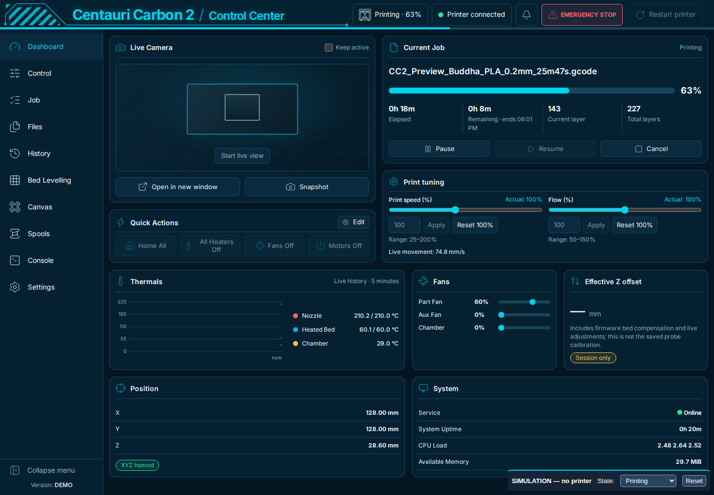
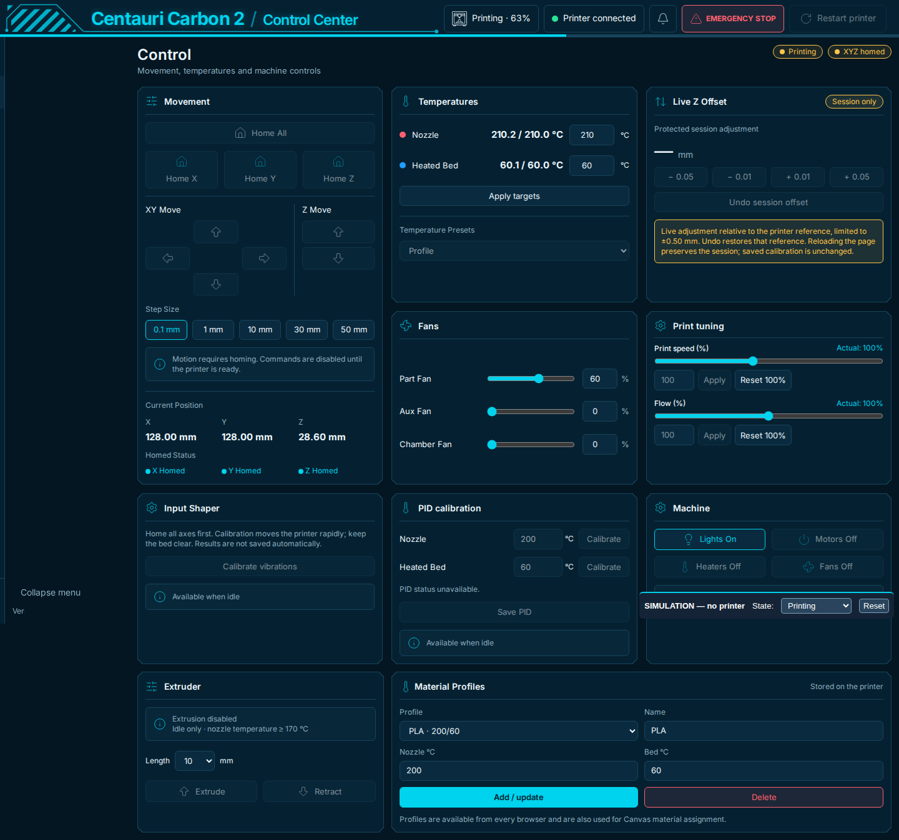
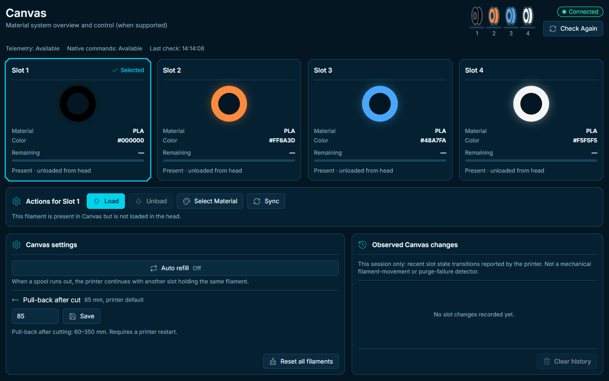
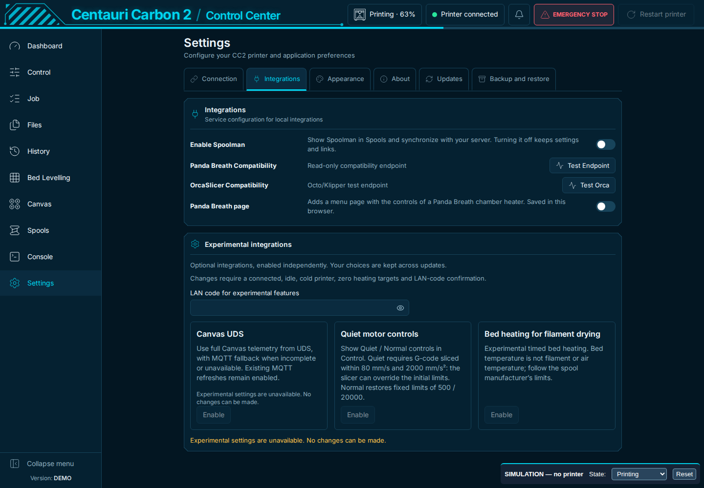

# Centauri Carbon 2 Community Firmware

Community firmware, local printer control and reproducible build tools for the
**ELEGOO Centauri Carbon 2**, maintained by **Neme77**.

> **NEW: PRINT TPU WITHOUT UNPLUGGING CANVAS — CC2 Control 1.2.23.** Optional in **Settings → Integrations → Experimental integrations**. Full PLA/TPU 95A cycle validated by **DamiBFryta**. [Download and details](https://github.com/Neme77/centauri-carbon-2-community/releases/tag/CC2-Control-1.2.23-V4.4).

  
  &nbsp;
  

| **🖨️ Complete firmware · V4.4.2** | **🔄 CC2 Control · 1.2.23** |
| --- | --- |
| [**Download signed firmware**](https://github.com/Neme77/centauri-carbon-2-community/releases/download/V4.4.2/CC2_V4_4_2_STOCK_20261024_125406_99842c8a.zip.sig) · [Release notes and checksums](https://github.com/Neme77/centauri-carbon-2-community/releases/tag/V4.4.2) | [**Download Windows / macOS / Linux package**](https://github.com/Neme77/centauri-carbon-2-community/releases/download/CC2-Control-1.2.23-V4.4/CC2-Control-1.2.23-Multiplatform-Update.zip) · [Release notes and checksums](https://github.com/Neme77/centauri-carbon-2-community/releases/tag/CC2-Control-1.2.23-V4.4) |
| Complete installation with CC2 Control **1.2.21** and the webcam fix already included. No extra reboot after firmware installation. | For community firmware **V4.4/V4.4.1/V4.4.2**. Includes the camera stability and recovery fixes. |

> **Optional experiment · Canvas pull-back R4:** [**Download the Windows / Linux / macOS kit**](https://github.com/Neme77/centauri-carbon-2-community/releases/download/CC2-Control-1.2.22-V4.4/CC2-Canvas-Pullback-Experimental-R4.zip). Extends the configurable limit up to 1000 mm on qualified **V4.4.1/V4.4.2** with Control **1.2.21/1.2.22**. By **Noahwhite2014**. [Instructions](experimental/canvas-pullback-kit/README.en.md). Remove the component and reboot before app/firmware updates.

**Updating from the CC2 Control panel?** [Download the signed `.cc2update` file](https://github.com/Neme77/centauri-carbon-2-community/releases/download/CC2-Control-1.2.23-V4.4/CC2-Control-1.2.23-V4.4.cc2update) and select it in **Settings → Updates**. For app-only updates, reboot while idle only on first activation of the camera fix; it is already active for users coming from 1.2.19. Complete V4.4.2 installation needs no additional reboot.

[Italiano](README.it.md) · [Documentation](docs/README.md) · [Downloads](https://github.com/Neme77/centauri-carbon-2-community/releases) · [Screenshots](docs/SCREENSHOTS.md)

> Independent community project, not affiliated with or supported by ELEGOO.
> This project targets the **Centauri Carbon 2**, not the first Centauri Carbon.

  

## Get started

| What you need | English | Italiano |
| --- | --- | --- |
| Install the complete community firmware | [First installation](docs/FIRST_RUN.md) | [Prima installazione](docs/FIRST_RUN.it.md) |
| Update an existing CC2 Control installation | [Application updates](docs/UPDATE_CC2.md) | [Aggiornamenti dell’app](docs/UPDATE_CC2.it.md) |
| Connect OrcaSlicer and synchronize Canvas slots | [OrcaSlicer setup](docs/ORCASLICER.md) | [Configurazione OrcaSlicer](docs/ORCASLICER.it.md) |

Download files from [GitHub Releases](https://github.com/Neme77/centauri-carbon-2-community/releases)
and follow the matching guide and release notes. **Complete firmware**, the
**CC2 Control application** and the **source builder** are different downloads:
the builder ZIP is not an installable printer update. Check the supplied SHA-256
checksums before installation.

The current qualified firmware family is **V4.4/V4.4.1/V4.4.2**, based on ELEGOO
**02.01.01.07**. Its application updates are not interchangeable with stock
firmware, older community firmware or experimental builds.

Open **`http://PRINTER-IP:8081`** on your local network. OrcaSlicer also needs
**`:8081`** after the printer IP. App installation requires the printer’s **LAN
access code**, which is different from the SSH password; checking for updates
does not. Installation always requires confirmation. Camera-component updates
require a **full printer reboot** as described in their release notes.

## What CC2 Control offers

- Local dashboard, live video, temperatures, fans, print speed and flow controls.
- Internal/USB files, model previews and interactive object exclusion.
- Canvas slot states, material settings, auto refill and OrcaSlicer filament sync.
- Bed leveling, saved plate/nozzle meshes and optional spool inventory/tracking.
- Backup and selective restore, diagnostics, protected Console and signed app updates.
- Multiple interface languages, themes and desktop/mobile layouts.

See the [application guide](docs/CC2_CONTROL.md) and [screenshot gallery](docs/SCREENSHOTS.md).
Experimental features remain opt-in and require their own validation.

## New in CC2 Control 1.2.23

### **PRINT TPU WITHOUT DISCONNECTING CANVAS**

Enable **External spool with Canvas connected** under **Settings → Integrations → Experimental integrations**, then select External spool in Canvas or Control. It remains **EXPERIMENTAL, optional and off by default**. A direct external filament path is required: TPU does not run through Canvas. Native source selection keeps Canvas connected and communicating.

**DamiBFryta, our definitive beta tester, validated the full PLA → TPU cycle, including eSUN TPU 95A printing, without unplugging Canvas: no issues and no errors.** Neme77 validated external PLA loading/purge, a completed print and return to normal Canvas loading. Other flexible materials, hardness and paths need their own validation. Native loading/purge speeds are unchanged.

[External-feed instructions](https://github.com/Neme77/centauri-carbon-2-community/blob/main/cc2-control/docs/EXTERNAL_FEED_EXPERIMENT.md).

[**CC2 Control 1.2.23: download and complete release notes**](https://github.com/Neme77/centauri-carbon-2-community/releases/tag/CC2-Control-1.2.23-V4.4).

## New in CC2 Control 1.2.22

> **Corrected in 1.2.23:** the Updates text now correctly points to Settings → Integrations. Sorry for the earlier misleading wording.

- **External spool, including printers bought without the Canvas Combo:** native **Load / Unload** when Canvas is confirmed absent, plus **Brand → Type → Subcategory → Colour** editing. Canvas shares the stock material catalog and 24-colour palette (#233). External feeding with Canvas connected is available as an opt-in experiment starting in 1.2.23.
- **Dashboard:** pezso92’s paused-camera artwork, speed/flow sliders alongside numeric Apply/Reset controls, aligned panels and **Keep active** in the camera header (#223).
- **Control:** compact machine actions, live Z offset above print tuning and aligned calibration panels (#226).
- **Spoolman:** optional server sync by **tharje** (#208), independently enabled in Integrations; configuration and local tracking are kept when disabled (#227).
- **LAN code:** optional verified browser-local remembering, masked prefilled fields and explicit Forget (#225).
- **Print completion:** nonblocking filename/duration notice, Confirm and Print again; idle progress clears without homing (#219).
- **Spool history:** bounded scrolling with All / Consumption-only filters, suggested by **DamiBFryta** (#220).
- **Experimental integrations:** Canvas UDS, Quiet and timed bed heating grouped in Settings → Integrations, independently enabled with aligned actions (#223/#232).
- **Filament drying experiment:** finite timed bed heating, explicit stop and zero-target confirmation (#198/#218/#230); requested by **romeopuch**, native help-check issue diagnosed by **Noahwhite2014**, documentation clarified by **pezso92** (#235).
- **Updates and packaging:** supported-version notices corrected in all nine languages (#222); unused firmware web overlay removed (#229). Cumulative webcam fix, preferences, mesh libraries and backups retained.

### Optional extended Canvas pull-back

[**Separate experimental Windows / Linux / macOS kit**](https://github.com/Neme77/centauri-carbon-2-community/releases/download/CC2-Control-1.2.22-V4.4/CC2-Canvas-Pullback-Experimental-R4.zip), by **Noahwhite2014** (#228). Qualified **V4.4.1/V4.4.2 only**, with Control **1.2.21/1.2.22**. Raises the accepted range up to 1000 mm without choosing a distance or sending movement; suitability depends on the filament path. **Remove it and reboot before app/firmware updates.** Never installed by the automatic updater. [Instructions](experimental/canvas-pullback-kit/README.en.md).

Canvas layout inspired by **Surfoo**; original Quiet feature by **BorjaLL**. Experiments retain saved choices. Previews use simulated data. Full V4.4.2 firmware and builder still include Control 1.2.21; install this app update for the new features.

[Release notes / Note complete, validation, checksums and credits](https://github.com/Neme77/centauri-carbon-2-community/releases/tag/CC2-Control-1.2.22-V4.4).

## Help and development

[Documentation index](docs/README.md) · [Report a problem](https://github.com/Neme77/centauri-carbon-2-community/issues) · [Contributing](CONTRIBUTING.md) · [Build guide](docs/BUILD.md) · [Source and provenance](docs/SOURCE.md)

Version history belongs in the [CHANGELOG](CHANGELOG.md) and
[release notes](https://github.com/Neme77/centauri-carbon-2-community/releases).
Installation details and compatibility requirements are maintained in the guides
linked above.

## Community

Thanks to **Surfoo, beanbo, efiten, Skcycos, pezso92, asiersan, Noahwhite2014,
tharje, Nick Plateringen-Paul**, and every contributor, translator and tester.
Special thanks to **[DamiBFryta](https://www.reddit.com/user/DamiBFryta/), our
ultimate beta tester**. [Full credits and original contributions](docs/CONTRIBUTORS.md).

AI-assisted work is reviewed and validated. Architecture decisions, printer-side
testing and release approval remain with the maintainer and community testers.

## License

Project code is GPL-3.0-only where contributors have the right to license it.
Vendor firmware and third-party components retain their own terms.
See [LICENSE](LICENSE) and [NOTICE.md](NOTICE.md).
