# Centauri Carbon 2 Community Firmware

A community firmware and local control experience for the **ELEGOO Centauri
Carbon 2**, maintained by **Neme77** and built with the community.

[Discord](https://discord.gg/FGfCaFpm38) · [Facebook](https://www.facebook.com/groups/1658610779139107) · [Support](https://github.com/Neme77/centauri-carbon-2-community/issues) · [Contributors](docs/CONTRIBUTORS.md)

## CC2 Control 1.2.30 — a stronger foundation for future updates

A substantial cumulative update: better print preparation, clearer filament
management, new themes, native touchscreen improvements and a managed update
path with a verified return to the previous installation.

This release brings together months of community work: original contributions,
reviews, translations, integration, compatibility investigations and patient
printer testing. The [changelog](CHANGELOG.md) records the individual changes;
the [credits](docs/CONTRIBUTORS.md) preserve their authors and testers.

| Get started | Where to go |
| --- | --- |
| Already on a recognised Community 4.4.4, Universal 07 or 07 HU installation | [**Download the signed 1.2.30 update (.cc2update)**](https://github.com/Neme77/centauri-carbon-2-community/releases/download/CC2-Control-1.2.30-V4.4.4-Universal/CC2-Control-1.2.30-Universal.cc2update) · [SHA-256](https://github.com/Neme77/centauri-carbon-2-community/releases/download/CC2-Control-1.2.30-V4.4.4-Universal/CC2-Control-1.2.30-Universal.cc2update.sha256.txt) · [Update guide](docs/MANAGED_UPDATES.md). Available through the bell / Settings → Updates as well. |
| First installation | [Complete Universal 07 firmware](https://github.com/Neme77/centauri-carbon-2-community/releases/download/V4.4.4/CC2_4.4.4_UNIVERSAL_07_HU_02.01.01.13.zip.sig) · [First-run guide](docs/FIRST_RUN.md) · [Firmware upgrade guide](docs/FIRMWARE_UPGRADE.md) |
| Exact downloads, checksums and release status | [GitHub Releases](https://github.com/Neme77/centauri-carbon-2-community/releases) |

**Manual update:** download the `.cc2update` file above, keep it intact, and upload it in **Settings → Updates** in CC2 Control. Follow the [update guide](docs/MANAGED_UPDATES.md) with a cold, idle printer.

The complete Universal 07 firmware remains based on **ELEGOO 02.01.01.13**
and installs CC2 Control 1.2.29. The signed 1.2.30 application update is a
separate package. An older 4.4.3 installation must first follow the documented
firmware migration; it is not a direct target of this application package.

### Highlights

- **Print preparation:** filament-bound queues, previews in Files and History,
  safer USB print import, a per-file layer map and improved live job views.
- **Bed levelling:** streamlined four-screw measurements, a fixed front-left
  reference with optimisation only by explicit choice, and comparison of saved
  meshes in 3D, heat-map and table views.
- **Canvas and Spoolman:** clearer slot-write feedback, corrected colour import,
  paged spool catalogues and visible handling of consumption awaiting delivery.
  Uncertain consumption is not automatically sent twice.
- **Camera and responsiveness:** a floating camera mini player, fewer unchanged
  console transfers and start-page cache revalidation.
- **Appearance:** twelve browser themes, including Aurora, Klipper, Dune, Swamp
  and KlipperScreen, with the Swamp selected-button readability fix. The browser
  interface supports eleven languages.
- **Original touchscreen:** fourteen selectable languages, including Hungarian,
  Czech and Polish, corrected large G-code previews, and a themed Back button
  that suppresses the touch passing through to the previous screen.

### Original touchscreen, Community theme

<a href="docs/images/native-display.png">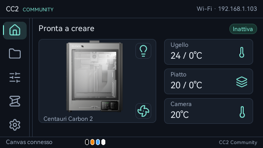</a>

Existing project capture of the Community Home screen. Additional languages
are selected in the touchscreen's language menu; this image is not a capture
of that menu. The browser themes and the native touchscreen theme are separate.

## Open, extensible RFID — with validation still to do

Use the Canvas reader beyond the original producer filter:
**scan → review material, colour and temperatures → choose a slot → confirm**.
Material assignment and physical filament presence remain separate.

Activation is **optional and requested from Settings → Integrations**. Follow
the restart and validation prompts; the original Canvas firmware can be
restored. Once confirmed, the activation cannot be cancelled: CC2 Control
refuses printer changes until it is complete, and going back means restoring
the original Canvas firmware (a second transfer and two more full reboots). A Centauri Carbon 2 without Canvas needs no RFID activation, and
external-spool printing remains available.

The decoder and integration are open to new layouts and implementations.
Tested tag families do **not** establish universal compatibility with every
brand. Reports and documented tag-layout contributions will help expand that
coverage. Please include reproducible evidence; avoid publishing personal tag
data or credentials. Decoder-layout attribution remains with
**OpenRFID / DnG-Crafts**.

## The CC2 Control experience

| Area | Available workflows |
| --- | --- |
| Dashboard and printing | Printer/job state, progress, temperatures, fans, live Z offset, camera, quick actions and emergency stop. |
| Files and slicers | Internal/USB G-code management, previews, upload, print setup, calibrated starts, print history and OrcaSlicer integration. |
| Queue | Prepare jobs and copies in advance. The normal continuation waits for the operator; automatic continuation is an explicit choice for an appropriate self-clearing-bed workflow. |
| Job map | Objects, exclusion and a thinned extrusion path for the selected layer. Enable object labelling in OrcaSlicer to access the current expanded map; path parsing itself does not require labels. |
| Plates and calibration | Build-plate library, Side A/B, stored meshes, temperature/nozzle-aware workflows, screw levelling/tramming, PID, Pressure Advance, Input Shaper and advanced calibration tools. |
| Filament | Canvas slots, external spool/TPU, local spool inventory, Spoolman connection, material profiles and reviewed RFID assignment where supported. |
| Thermal and fans | Nozzle/bed targets, chamber heating and filament drying, native fans, optional EXHAUST minimum and flap controls. Accessory integrations depend on the connected hardware. |
| Connections | Wi-Fi profiles, DHCP/static configuration and qualified USB Ethernet with confirmation/recovery. Unsupported adapters are not silently enabled. |
| Settings and upkeep | Themes and eleven languages, LAN-code configuration, selective app backups, updates with progress/logs, integrations and diagnostics. |

Features and controls depend on the hardware and current printer state. The
presence of an integration does not mean every accessory or combination has
been physically qualified. See the [changelog](CHANGELOG.md),
[testing guide](docs/TESTING.md) and [API documentation](cc2-control/docs/API.md).

## CC2 Control in pictures

Actual screenshots from the 1.2.29 panel. Click any preview to open the
full-size PNG in your browser. Available controls depend on printer state and
connected accessories.

<table>
  <tr>
    <td width="50%" valign="top">
      
<strong>Dashboard, live camera and first-layer overview</strong>

      <a href="https://raw.githubusercontent.com/Neme77/centauri-carbon-2-community/develop/docs/images/control-dashboard.png">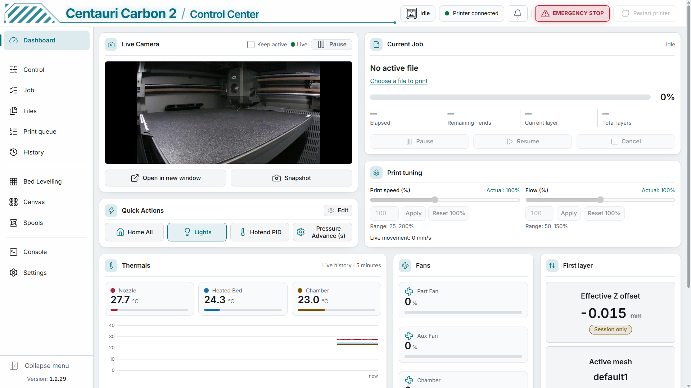</a>
    </td>
    <td width="50%" valign="top">
      
<strong>Movement, cooling and calibration controls</strong>

      <a href="https://raw.githubusercontent.com/Neme77/centauri-carbon-2-community/develop/docs/images/control-control.png">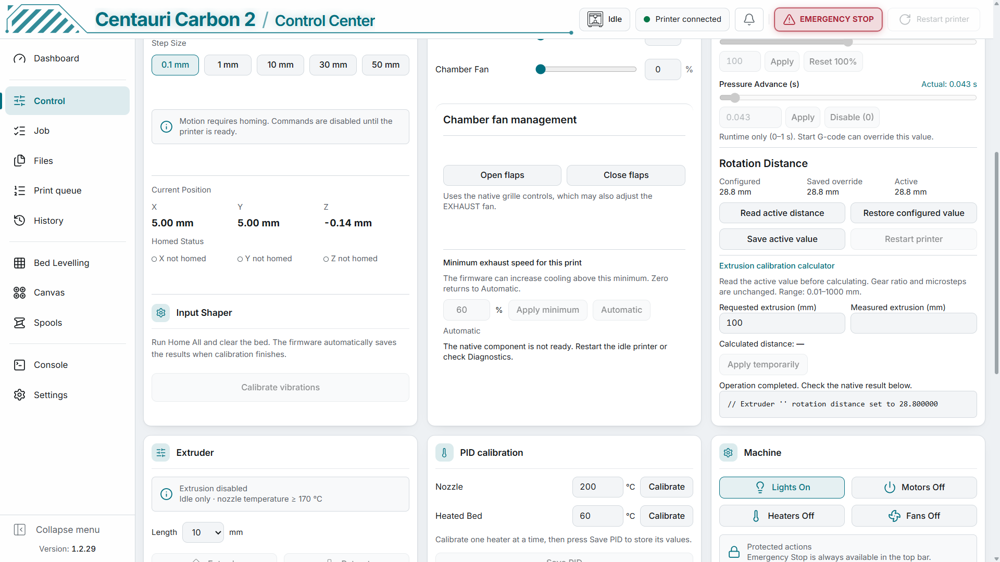</a>
    </td>
  </tr>
  <tr>
    <td width="50%" valign="top">
      
<strong>Current job, camera and object exclusion</strong>

      <a href="https://raw.githubusercontent.com/Neme77/centauri-carbon-2-community/develop/docs/images/control-job.png">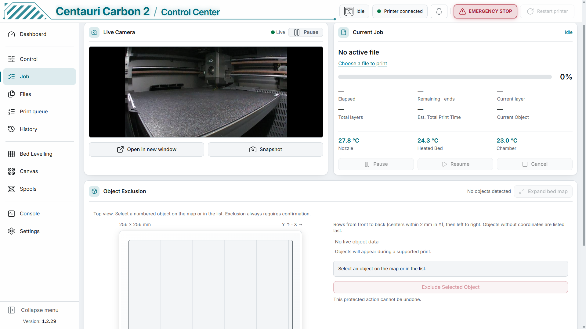</a>
    </td>
    <td width="50%" valign="top">
      
<strong>Interactive 3D bed mesh</strong>

      <a href="https://raw.githubusercontent.com/Neme77/centauri-carbon-2-community/develop/docs/images/control-bed-mesh.png">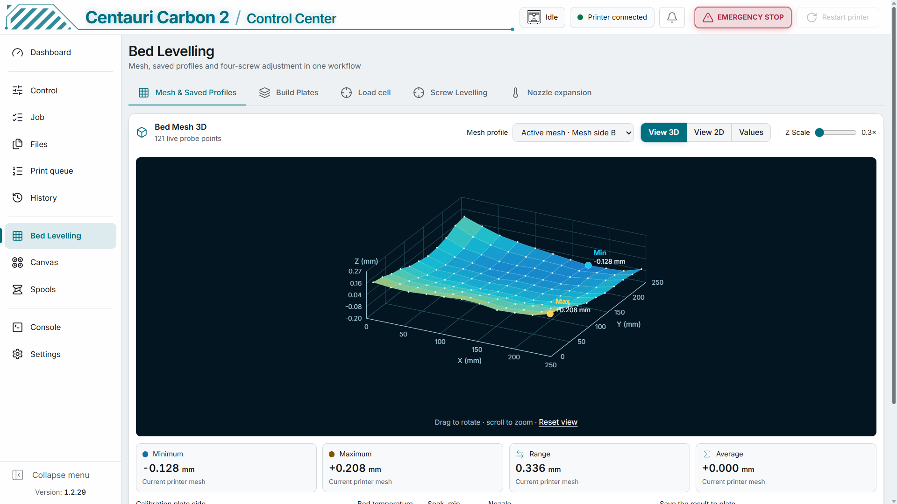</a>
    </td>
  </tr>
  <tr>
    <td width="50%" valign="top">
      
<strong>Canvas slots, external spool and RFID actions</strong>

      <a href="https://raw.githubusercontent.com/Neme77/centauri-carbon-2-community/develop/docs/images/control-canvas.png">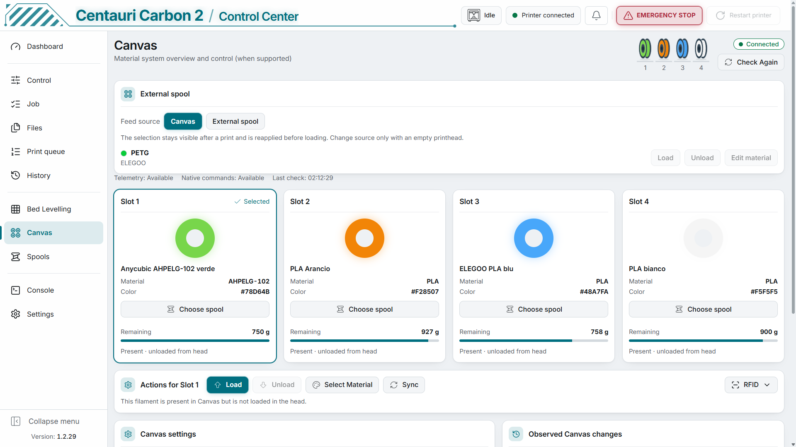</a>
    </td>
    <td width="50%" valign="top">
      
<strong>Spool tracking and filament inventory</strong>

      <a href="https://raw.githubusercontent.com/Neme77/centauri-carbon-2-community/develop/docs/images/control-spools.png">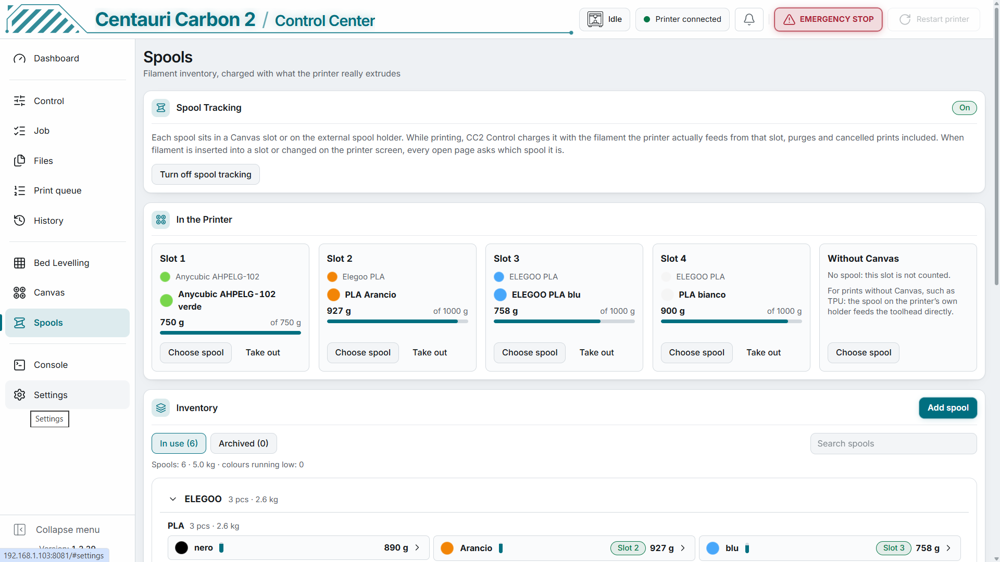</a>
    </td>
  </tr>
  <tr>
    <td width="50%" valign="top">
      
<strong>Wi-Fi and USB Ethernet connection confirmation</strong>

      <a href="https://raw.githubusercontent.com/Neme77/centauri-carbon-2-community/develop/docs/images/control-connections.png">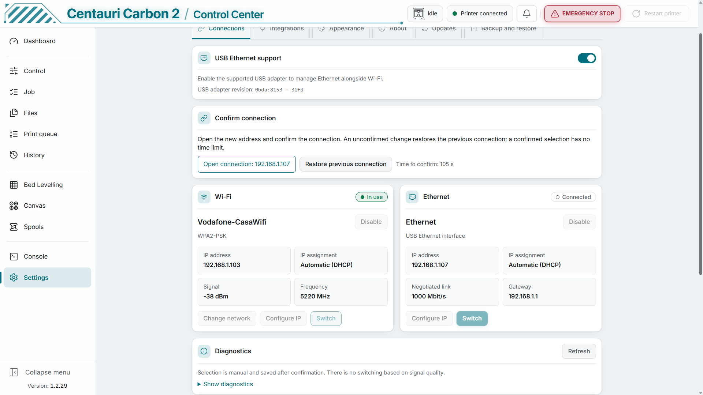</a>
    </td>
    <td width="50%" valign="top">
      
<strong>Optional integrations in the dark theme</strong>

      <a href="https://raw.githubusercontent.com/Neme77/centauri-carbon-2-community/develop/docs/images/control-integrations.png">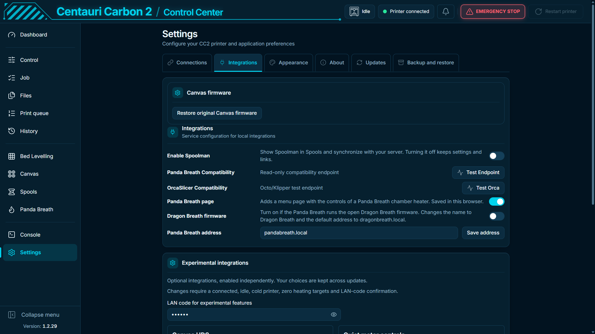</a>
    </td>
  </tr>
</table>

## Built, tested and recoverable

The integrated update was exercised offline in an ARM environment with the real
procd/ubus services on three recognised bases: published 4.4.4, Universal 07
and 07 HU. The sequence covered installation, full rollback, reinstallation
and a second rollback. Existing byte-identical test evidence was reused.

The final package also completed installation, reboot, full rollback and another
reboot on the maintainer's printer. Display languages, previews, Back, Canvas,
Wi-Fi, light and panel were checked. RFID file hashes remained unchanged during
both operations. This is separate from the earlier community migration tests.

The managed updater checks recognised components, stages the panel separately
and retains rollback evidence. Updates remain notified through the bell;
compatible future panel updates use the panel manager. Changes to the native
firmware still need their own compatibility qualification.

These checks make the update path more robust; they do not establish support
for every modified installation or eliminate power-loss and hardware risks.
The native Canvas auto-refill reports remain a separate investigation: no
auto-refill fix is claimed by the Spoolman changes.

## CC2 Assist: illustrated FEL recovery guide

[**Download CC2 Assist for Windows — FEL beta**](https://github.com/Neme77/centauri-carbon-2-community/releases/download/CC2-Control-1.2.30-V4.4.4-Universal/CC2-Assist-0.7.0-FEL-Beta-r2.zip) · [ZIP checksum](https://github.com/Neme77/centauri-carbon-2-community/releases/download/CC2-Control-1.2.30-V4.4.4-Universal/CC2-Assist-0.7.0-FEL-Beta-r2.zip.sha256.txt) · [**Step-by-step illustrated guide**](docs/CC2_ASSIST.md)

Extract the whole ZIP and open **CC2-Assist.exe**. English and Italian are
available in the app. The ZIP includes XFEL, the .13 + SSH recovery images,
English instructions, the cable guide and report checklists.

<table>
<tr>
<td width="45%" valign="top"><strong>Real mainboard reference</strong> 
<a href="docs/images/cc2-assist/cc2-mainboard-reference.jpg">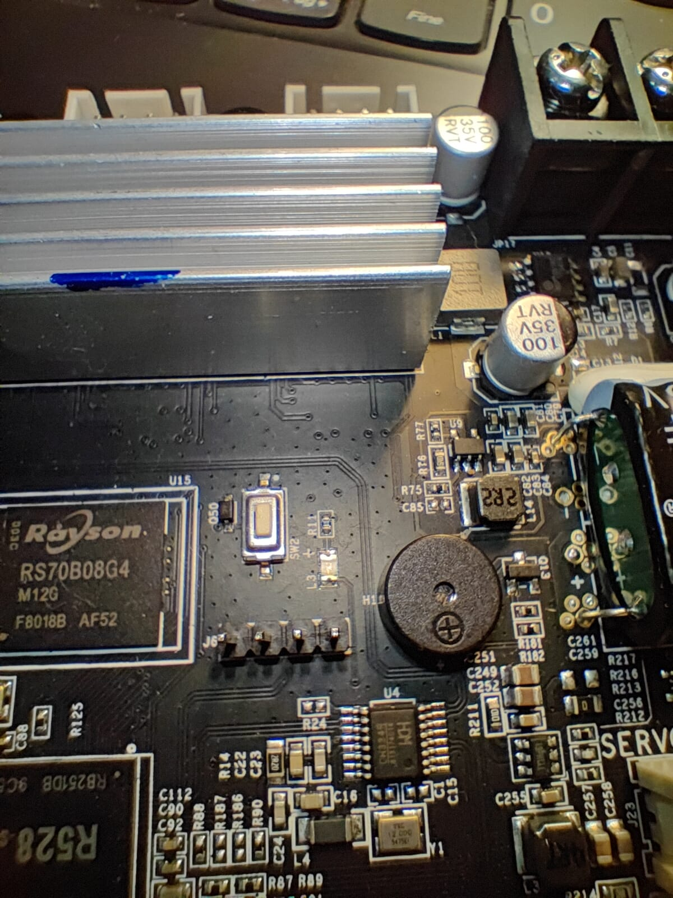</a></td>
<td width="55%" valign="top"><strong>Cable wiring and orientation</strong> 
<a href="docs/images/cc2-assist/cc2-fel-cable-map.svg">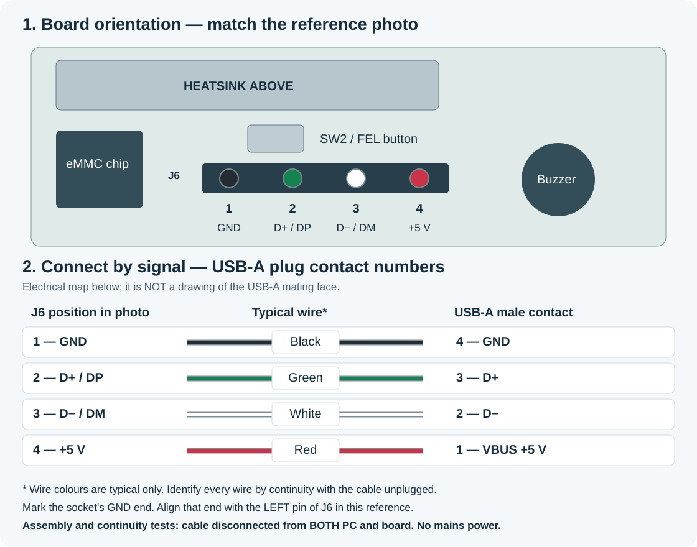</a></td>
</tr>
</table>

1. **Prepare the cable:** follow the [photo, electrical mapping and continuity checks](docs/CC2_ASSIST.md#1-make-and-check-the-usb-fel-cable), with the cable unplugged at both ends.
2. **Read first:** disconnect printer mains, enter FEL using USB power only, identify the board and save a new read-only collection.
3. **Prepare and check:** generate the kit from that board's collection and wait for **GENERIC_FEL_READ_ONLY_PASSED**. A working printer can stop here.
4. **Recover only if needed:** factory recovery resets settings, G-code and calibrations. Wait for **FACTORY_RECOVERY_READY_FOR_MANUAL_BOOT_A** before disconnecting USB and booting manually on mains.
5. **Finish and report:** reconnect Wi-Fi, use **Finish recovery** to verify and save the protected identity/RFID backup, then retain the AFTER reports.

**Never combine PC USB power and printer mains in this procedure.**
Factory recovery is designed to preserve identity and RFID files and does not
flash the Canvas MCU. Its newer complete overlay/user-data reset remains
**beta and physically unverified on populated user data**. SSH cleanup is a
separate workflow that preserves calibrations. Read the [complete guide](docs/CC2_ASSIST.md)
before connecting or writing; keep private reports out of public issues.

## Recovery tools and support

**CC2 Assist** provides SSH diagnosis, verified backups and reviewed archive
cleanup. Cleanup has been exercised successfully on a real printer while
preserving RFID, calibrations and active components.

Its **FEL recovery remains beta**. Read-only collection was tried on both known
eMMC capacity variants; A-image writing, readback and boot to original-base
.13 + SSH were demonstrated on a spare board. The newer complete reset of
overlay and user data has offline validation but still needs a physical trial
with populated data. Factory reset clears settings, files and calibrations;
it is a different operation from SSH cleanup. Recovery images with SSH are
modified images, not byte-identical vendor firmware. See the release's included
English instructions, cable orientation guide and before/after report checklist.

**If something goes wrong, we will help investigate.** Open a
[support issue](https://github.com/Neme77/centauri-carbon-2-community/issues/new/choose)
with starting versions, exact package and the failed step. Keep logs and verified
backups. Send private captures privately, without posting passwords or LAN codes.
A refusal needs diagnosis; repeated flashing or deleting recovery records is
not a substitute. The clean firmware edition will follow separately.

## Built with the community

Thanks to **Surfoo**, **beanbo**, **Noahwhite2014**, **lpgamerzockt-ops**,
**pezso92**, **Skcycos**, the translators, reviewers and everyone who contributed
ideas, logs and printer time. Special thanks to the people who reproduced the
upgrade failures and helped verify the recovery paths. Firmware integration
and the extended physical qualification were carried out by **Neme77**.
Original authorship and the wider project history remain in the
[full credits](docs/CONTRIBUTORS.md) and [changelog](CHANGELOG.md).

Special thanks to the **#327** testers and investigators: **Eldurinn**,
**kalross**, **jgj1107**, **matefon**, **SVLoneStar**, **fechy**,
**RoisinDubh79**, **lpgamerzockt-ops** and **Noahwhite2014**. Their different
installation states, trial reports and recovery confirmations made the upgrade
work more complete. [Individual contributions and report scope](docs/UPGRADE_CREDITS.md).

[Ryzehosting](https://ryzehosting.com/) — Thank you very much for supporting our project.

## Buy me a coffee

If you enjoy my work and would like to buy me a coffee, your optional support
helps me keep developing, testing and exploring support for additional printer
models. The project remains open; a contribution is not required to use it and
does not promise support for an untested printer.

[Support the project with PayPal](https://www.paypal.com/cgi-bin/webscr?cmd=_donations&business=gino.nencioni%40gmail.com&item_name=CC2%20Community%20Firmware&currency_code=EUR)

## Sources and notices

[Source/build information](docs/SOURCE.md) · [License](LICENSE) ·
[Third-party notices](NOTICE.md) · [Release process](RELEASING.md)

Community code and vendor firmware have distinct licensing scopes. Obtain
required vendor/build inputs separately; private signing material and printer
credentials are not included in the source repository.
