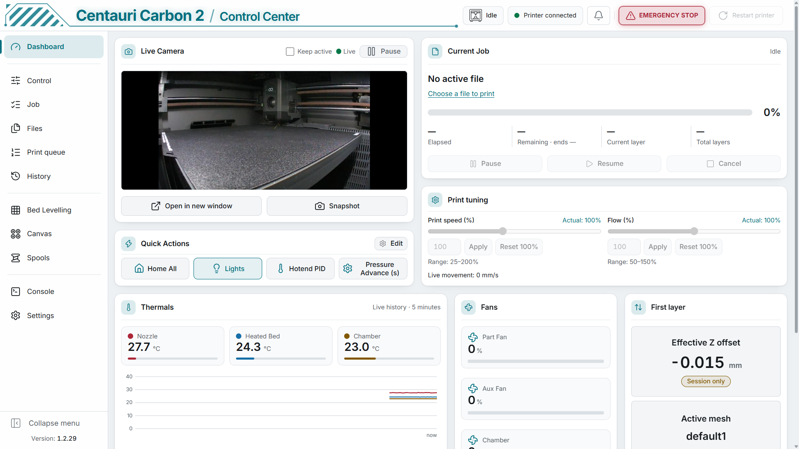
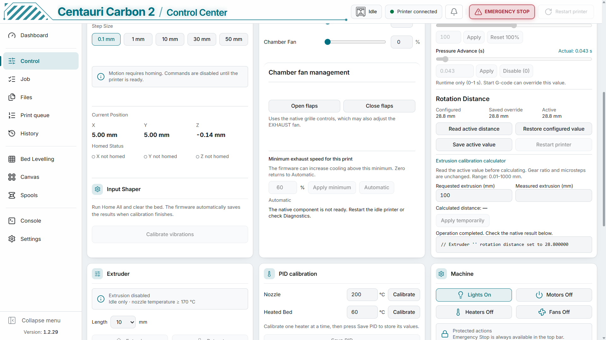
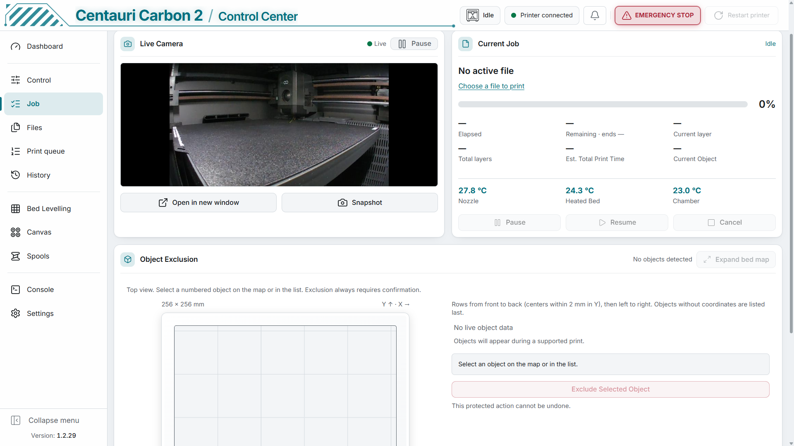
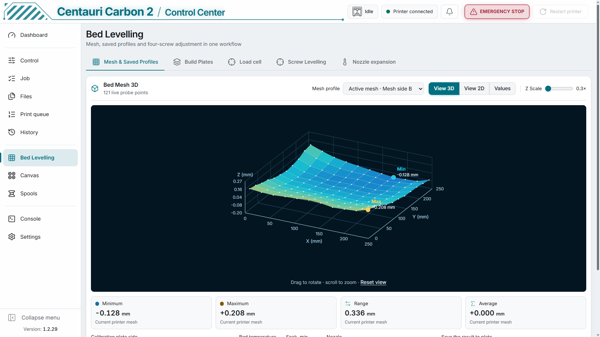
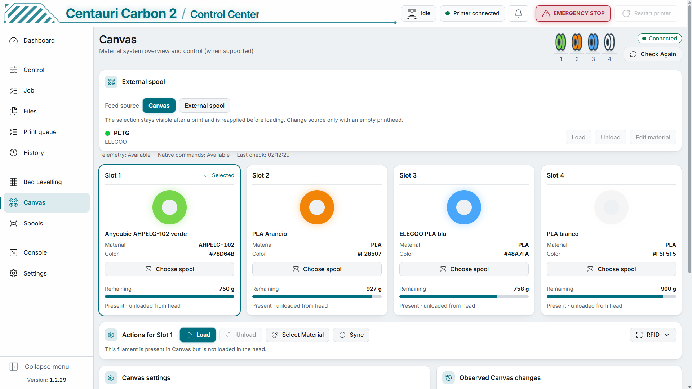
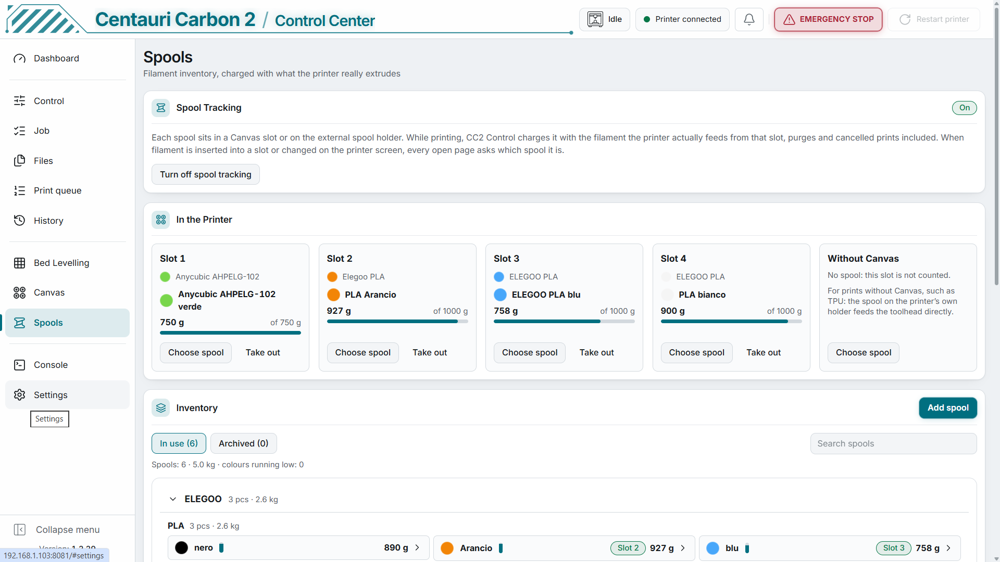
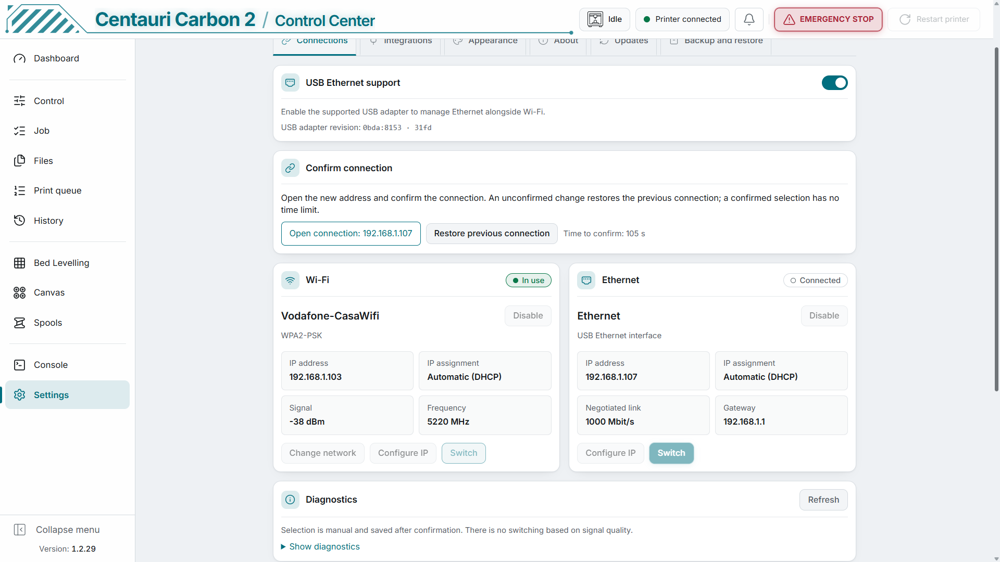
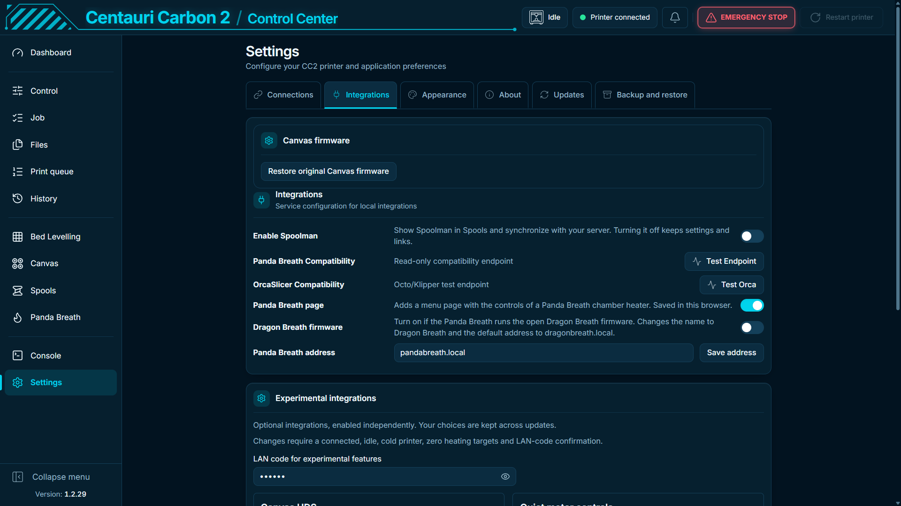

# Centauri Carbon 2 Community Firmware

A complete community firmware and local control experience for the **ELEGOO
Centauri Carbon 2**, maintained by **Neme77** with contributions and printer
testing from the community.

[Discord](https://discord.gg/FGfCaFpm38) ·
[Facebook group](https://www.facebook.com/groups/1658610779139107) ·
[Report a problem](https://github.com/Neme77/centauri-carbon-2-community/issues) ·
[Contributors](docs/CONTRIBUTORS.md)

## Community Firmware 4.4.4 · ELEGOO base 02.01.01.13 · CC2 Control 1.2.29

**Installation is simple again: copy the firmware to USB and run Offline Update.**

After extensive work on incompatibilities left by different earlier update
branches, **Universal 07 automatically migrates the recognised installations**.
It resolves the incompatibility cases identified and verified so far, including
the reviewed inactive legacy variant, and retains personal data.
The published variant also includes the Hungarian corrections from PR #352.

**No mandatory probe, manual cleanup, downgrade, intermediate panel update or
Canvas restoration for a supported upgrade.** Finish an ongoing Canvas action
and its requested reboots first. A Canvas is optional; recognised active,
inactive and restored RFID states are handled automatically.

| Download | Purpose |
| --- | --- |
| [Community Firmware 4.4.4 · Universal 07](https://github.com/Neme77/centauri-carbon-2-community/releases/download/V4.4.4/CC2_4.4.4_UNIVERSAL_07_HU_02.01.01.13.zip.sig) | Complete firmware: copy the unchanged .zip.sig to USB and use Offline Update. |
| [First installation](docs/FIRST_RUN.md) · [Upgrade guide](docs/FIRMWARE_UPGRADE.md) | Short installation steps, backup advice and startup checks. |
| [Release notes and checksums](https://github.com/Neme77/centauri-carbon-2-community/releases/tag/V4.4.4) | Exact package identity, sources and validation scope. |

Use the **Universal 07** download above. The original RC6-based V4.4.4 file and
its preparation kit are historical; their mandatory preparation instructions
do not apply to this revision. The separate Recovery package is not released.
CC2 Control application-only updates remain a different installation path.

## What is new on the .13 base

- **Native touchscreen:** Community Home, Network, colour palette and Z-offset
  integration, retaining the original printer controls.
- **Camera and connectivity:** ported Camera Recovery and native LAN/WAN
  compatibility; local video, Matrix, ELEGOO Slicer and OrcaSlicer received
  printer trials. Optional qualified RTL8153 USB Ethernet works alongside Wi-Fi.
- **Native features:** Reactor, EXHAUST minimum, flap controls and extended
  Canvas pullback are integrated into the new base. The original ELEGOO pullback
  default is retained until the operator changes it; the supported range now
  extends to 1000 mm.
- **First-layer dashboard:** effective Z offset, session-only indication, active
  mesh and plate side in one card. Heater indicators show whether heating is
  active, rather than inferring it from measured temperature.
- **Print preparation:** a print queue, live G-code layer paths, interactive
  screw tramming and history, and responsive background USB file import.
- **Maintenance:** update progress and installation logs, clearer Canvas
  restart validation, revised drying shutdown recovery and Quiet motors fixes.
- **Readability and languages:** improved themes and eleven interface languages,
  with German, Turkish and recent Hungarian/Chinese refinements included.

Migration checks the actual installed components and lifecycle evidence rather
than relying on a panel version label. It preserves supported states and
archives replaced components. Unknown or inconsistent evidence is reported;
it is not silently erased.

## Open, extensible RFID — with validation still to do

Use the Canvas reader beyond the original producer filter:
**scan → review material, colour and temperatures → choose a slot → confirm**.
Material assignment and physical filament presence remain separate.

Activation is **optional and requested from Settings → Integrations**. Follow
the restart and validation prompts; the original Canvas firmware can be
restored. A Centauri Carbon 2 without Canvas needs no RFID activation, and
external-spool printing remains available.

The decoder and integration are open to new layouts and implementations.
Tested tag families do **not** establish universal compatibility with every
brand. Reports and documented tag-layout contributions will help expand that
coverage. Please include reproducible evidence; avoid publishing personal tag
data or credentials. Decoder-layout attribution remains with
**OpenRFID / DnG-Crafts**.

## The CC2 Control experience

| Area | Available workflows |
| --- | --- |
| Dashboard and printing | Printer/job state, progress, temperatures, fans, live Z offset, camera, quick actions and emergency stop. |
| Files and slicers | Internal/USB G-code management, previews, upload, print setup, calibrated starts, print history and OrcaSlicer integration. |
| Queue | Prepare jobs and copies in advance. The normal continuation waits for the operator; automatic continuation is an explicit choice for an appropriate self-clearing-bed workflow. |
| Job map | Objects, exclusion and a thinned extrusion path for the selected layer. Enable object labelling in OrcaSlicer to access the current expanded map; path parsing itself does not require labels. |
| Plates and calibration | Build-plate library, Side A/B, stored meshes, temperature/nozzle-aware workflows, screw levelling/tramming, PID, Pressure Advance, Input Shaper and advanced calibration tools. |
| Filament | Canvas slots, external spool/TPU, local spool inventory, Spoolman connection, material profiles and reviewed RFID assignment where supported. |
| Thermal and fans | Nozzle/bed targets, chamber heating and filament drying, native fans, optional EXHAUST minimum and flap controls. Accessory integrations depend on the connected hardware. |
| Connections | Wi-Fi profiles, DHCP/static configuration and qualified USB Ethernet with confirmation/recovery. Unsupported adapters are not silently enabled. |
| Settings and upkeep | Themes and eleven languages, LAN-code configuration, selective app backups, updates with progress/logs, integrations and diagnostics. |

Features and controls depend on the hardware and current printer state. The
presence of an integration does not mean every accessory or combination has
been physically qualified. See the [changelog](CHANGELOG.md),
[testing guide](docs/TESTING.md) and [API documentation](cc2-control/docs/API.md).

## CC2 Control in pictures

Actual screenshots from the 1.2.29 panel. Click any preview to open the
full-size PNG in your browser. Available controls depend on printer state and
connected accessories.

<table>
  <tr>
    <td width="50%" valign="top">
      
<strong>Dashboard, live camera and first-layer overview</strong>

      
    </td>
    <td width="50%" valign="top">
      
<strong>Movement, cooling and calibration controls</strong>

      
    </td>
  </tr>
  <tr>
    <td width="50%" valign="top">
      
<strong>Current job, camera and object exclusion</strong>

      
    </td>
    <td width="50%" valign="top">
      
<strong>Interactive 3D bed mesh</strong>

      
    </td>
  </tr>
  <tr>
    <td width="50%" valign="top">
      
<strong>Canvas slots, external spool and RFID actions</strong>

      
    </td>
    <td width="50%" valign="top">
      
<strong>Spool tracking and filament inventory</strong>

      
    </td>
  </tr>
  <tr>
    <td width="50%" valign="top">
      
<strong>Wi-Fi and USB Ethernet connection confirmation</strong>

      
    </td>
    <td width="50%" valign="top">
      
<strong>Optional integrations in the dark theme</strong>

      
    </td>
  </tr>
</table>

## Tested work, stated limits

The upgrade programme includes maintainer and independent results from
Control 1.2.25, 1.2.26, 1.2.27, the reviewed private 1.2.28 variant and supported
.13 previews. These reports cover preserved settings, normal temperatures,
Canvas recognition and the available printing, camera and network checks.
RFID tag reads were checked where testers had compatible tags; reader arming
alone is not a full tag-read test.

Universal 07 adds the reviewed inactive legacy case. The Hungarian variant
changes only the web language catalogue; backend and migration are unchanged.
Its build and translation checks are recorded separately from physical trials.
This does not claim every unofficial build, corrupt state or accessory is
supported. Native-speaker review of the exact projected catalogue remains pending.

## Clearer updates from this base onward

Compatible **panel features** continue through the normal application-update
path, with their supported base declared. **Firmware/native changes with
uncertain compatibility** become a new complete firmware base with a documented
migration. This separation is intended to make future updates simpler and
their requirements easier to understand.

Contributors must document and test their own PRs using the reference
[contribution guidelines](CONTRIBUTING.md), [working rules](AGENTS.md),
[testing guide](docs/TESTING.md) and [release policy](RELEASING.md). CI supports
that evidence; it does not replace hardware testing or author responsibility.

## Recovery and support

Keep your existing verified backups; if needed, save panel data through
Settings → Backup and restore before installation. Migration retains component
archives on the printer. A reset or preparation script is not a routine step.

**If you encounter a problem, we are available to help.** The separate Recovery
package is still being completed; do not assume a universal reset or guaranteed
loss-free recovery exists for every unknown state.

If a check refuses the operation or the printer does not start correctly,
stop and [open a support issue](https://github.com/Neme77/centauri-carbon-2-community/issues/new/choose).
Include the starting firmware and CC2 Control versions, the exact package,
the failed step and its log. Redact passwords, LAN access codes and tokens.
Keep the backup, quarantine and installer logs; do not delete recovery records
or repeatedly flash firmware to bypass a refusal. We can then help identify the
appropriate recovery route. Follow the documented Canvas restoration steps
before returning to original ELEGOO firmware.

## Built with the community

Thanks to **Surfoo**, **beanbo**, **Noahwhite2014**, **lpgamerzockt-ops**,
**pezso92**, **Skycos**, the translators, reviewers and everyone who contributed
ideas, logs and printer time. Special thanks to the people who reproduced the
upgrade failures and helped verify the recovery paths. Firmware integration
and the extended physical qualification were carried out by **Neme77**.
Original authorship and the wider project history remain in the
[full credits](docs/CONTRIBUTORS.md) and [changelog](CHANGELOG.md).

Special thanks to the **#327** testers and investigators: **Eldurinn**,
**kalross**, **jgj1107**, **matefon**, **SVLoneStar**, **fechy**,
**RoisinDubh79**, **lpgamerzockt-ops** and **Noahwhite2014**. Their different
installation states, trial reports and recovery confirmations made the upgrade
work more complete. [Individual contributions and report scope](docs/UPGRADE_CREDITS.md).

## Buy me a coffee

If you enjoy my work and would like to buy me a coffee, your optional support
helps me keep developing, testing and exploring support for additional printer
models. The project remains open; a contribution is not required to use it and
does not promise support for an untested printer.

[Support the project with PayPal](https://www.paypal.com/cgi-bin/webscr?cmd=_donations&business=gino.nencioni%40gmail.com&item_name=CC2%20Community%20Firmware&currency_code=EUR)

## Sources and notices

[Source/build information](docs/SOURCE.md) · [License](LICENSE) ·
[Third-party notices](NOTICE.md) · [Release process](RELEASING.md)

Community code and vendor firmware have distinct licensing scopes. Obtain
required vendor/build inputs separately; private signing material and printer
credentials are not included in the source repository.
