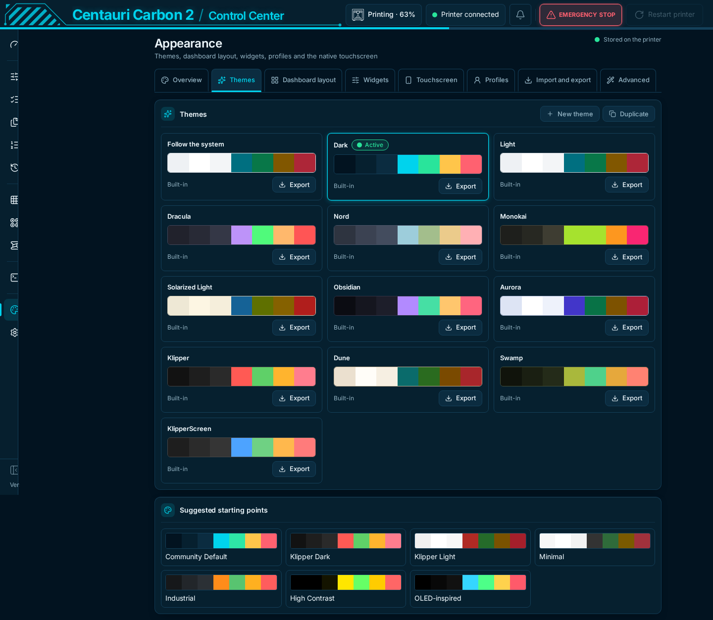

# Appearance, themes and touchscreen customisation

This document describes the appearance studio added to CC2 Control: browser
themes, dashboard layouts and widgets, profiles, import/export, and the
optional, reversible native-display pack for the printer touchscreen.

The browser UI and the native touchscreen are **separate rendering systems**.
They share a visual identity only through the small, verified subset described
here. The studio never claims that a browser theme appears on the touchscreen.



## What is supported

| Area | Status | Notes |
| --- | --- | --- |
| Browser themes | Stable | Twelve shipped palettes, system preference, unlimited-by-tokens custom palettes (up to 8 stored) |
| Colour tokens | Stable | Fourteen named tokens, validated as `#rrggbb`; no free-form CSS |
| Dashboard layouts | Stable | Classic layout unchanged; up to four custom grid layouts |
| Widgets | Stable | Enable/disable, width, compact density, per-widget accent, drag or arrow reordering |
| Profiles | Stable | Up to six named snapshots; apply, rename, duplicate, export, import, delete |
| Import/export | Stable | Versioned JSON, no credentials or printer data |
| Density, font, text size, corners, spacing, animations | Stable | Bounded values applied through CSS custom properties |
| Touchscreen accent, dark background, boot artwork | Experimental | Requires a firmware display manifest; on-disk PNG replacement only; full reboot |
| Touchscreen layout, fonts, icons, widget positions | Not supported | Owned by the proprietary LVGL program; not modified |
| Native program patching | Not part of this feature | The existing firmware builder continues to own the reviewed display patch |

## Browser architecture

- `web-src/src/lib/appearance.ts` is the schema, validation, colour maths,
  profile operations and CSS application layer.
- `web-src/src/pages/appearance.tsx` is the studio (`#appearance/<section>`).
- `web-src/src/pages/dashboard.tsx` renders the unchanged **classic** layout or
  a custom flat grid of the same widgets. Custom layouts are opt-in; the
  default remains classic.
- The backend is `src/appearance.h`, a single versioned document at
  `appearance.json` next to `ui-preferences.json` (normally
  `/opt/usr/cc2-control/appearance.json`). It is validated field by field,
  written atomically (temporary file, `fsync`, rename), kept at mode `0600`,
  and the previous accepted document is retained as `appearance.json.bak`.
- The legacy `/api/preferences` theme identifier is still written for
  compatibility. On first run the appearance document inherits the theme from
  `ui-preferences.json`, so upgrading does not change the visible palette.

### Design tokens

The studio edits these tokens, and nothing else:

`bg`, `panel`, `edge`, `text`, `muted`, `field`, `ink`, `cyan`, `green`,
`amber`, `red`, `blue`, `well`, `wellFg`.

`cyan` is the accent used by controls, `ink` is the text drawn on the accent,
and the remaining status colours are semantic. Custom palettes are stored as
named `custom-<slug>` themes; the selected theme is applied to
`:root[data-theme="custom"]` through inline custom properties. Built-in themes
keep their reviewed `index.css` blocks. The studio shows WCAG contrast ratios
for text, panels, fields and the accent.

Other bounded settings are stored as numbers or enums: density
(`comfortable`, `compact`, `spacious`), font (`Inter`, `system`, `monospace`),
text scale (`0.85`–`1.30`), corner radius (`0`–`24 px`), spacing (`0`–`2`),
animations on/off and a layout identifier. There is no custom CSS field.

### Widget identifiers

`camera`, `quick`, `job`, `tuning`, `thermal`, `fans`, `firstLayer`,
`position`, `system`.

Each layout stores an allow-listed, duplicate-free list. A layout may be empty.
`classic` is a marker for the original composition and is not edited.

## Configuration document

```json
{
  "version": 1,
  "activeProfile": "community",
  "dashboard": {
    "theme": "obsidian",
    "mode": "dark",
    "layout": "classic",
    "density": 0,
    "font": 0,
    "scale": 1,
    "radius": 12,
    "spacing": 1,
    "animations": true,
    "layouts": [
      { "id": "classic", "name": "Classic", "columns": 4, "widgets": [] },
      { "id": "custom-grid", "name": "Custom grid", "columns": 4, "widgets": [] }
    ]
  },
  "touchscreen": {
    "enabled": false,
    "linkAccent": true,
    "experimental": false,
    "accent": "#7eead8",
    "background": "#0a0c11",
    "boot": "community"
  },
  "themes": [],
  "profiles": [
    {
      "id": "community",
      "name": "Community Default",
      "dashboard": {},
      "touchscreen": {}
    }
  ]
}
```

Rules:

- Unknown JSON fields are ignored on read and never written back.
- Unknown theme identifiers and missing active layouts/profiles fall back to
  `dark`, `classic` and `community`; they do not fail the whole document.
- Invalid colours, identifiers, numeric ranges, duplicate identifiers and
  unknown widget ids are refused with HTTP 400 and leave the stored document
  unchanged.
- The profile limit is six, layouts four, custom themes eight, widgets nine.
  These are enforced by the bounded parser, not only by the UI.
- A damaged file is reported as `recovered: true` with the server's reason and
  defaults are served; it is **not** silently rewritten. Saving replaces it and
  keeps the previous bytes as `.bak`.

## Native touchscreen

### Why this is different

The touchscreen is rendered by a vendor LVGL program. It loads PNG resources
from `/opt/usr/images/theme_default`; `/opt/usr/images/current_theme` points to
the active theme directory. The program, its fonts, its layout and its icon
positions are not configurable through a supported interface.

The appearance studio can therefore replace only the presentation files named
in a **display manifest** that the firmware builder writes next to them:

- `role: "accent"` — the authored accent glyphs;
- `role: "background"` — the dark interface backgrounds;
- `role: "boot"` — the 100 boot frames.

The manifest also records the exact GUI hash, firmware base and every file
hash. Without it, `/api/display` reports `supported: false` and the touchscreen
section is read-only. **This is intentional:** no file is guessed from its
name.

> A Community firmware built before the manifest was introduced will report
> touchscreen customisation as unsupported until a firmware update includes
> `cc2-display-manifest.json`. The dashboard side remains fully usable.

### Apply pipeline

1. The browser reads `/api/display` and fetches only allow-listed PNGs.
2. Colour and artwork transforms run **in the browser** (Canvas), not on the
   printer:
   - accent: hue window 145–200°, saturation ≥ 0.22, luminance preserved;
   - background: dark tint with preserved relative luminance, clamped so the
     native light text stays readable;
   - boot artwork: converted to a small-palette 532×300 PNG and repeated for
     the fixed native frames.
3. The browser packs the PNGs into an uncompressed tar and uploads it as one
   bounded request (≤4 MiB).
4. The printer validates every tar header and checksum, every name against the
   manifest, every size, every IHDR dimension and every PNG chunk CRC before
   any target is touched. It also checks the GUI hash, the active theme
   directory, that the printer is idle and that no update is running.
5. Every original is copied to a verified baseline before its first change.
   A journal is written, files are replaced atomically and read back.
6. On failure the baseline is restored. On power loss, the journal is replayed
   at the next CC2 Control start; the status reports `recoveryRequired` while a
   journal remains.
7. A complete printer reboot loads the new files. The notice clears when the
   native GUI process restarts (a CC2 Control restart alone does not clear it).

### Restore

“Restore original display” copies the verified baseline back. It refuses if a
display file was changed by something else or if the firmware display identity
changed after the backup; in that case use the original firmware/panel
procedure or reflash. Restoring the native display is independent of resetting
the dashboard appearance.

### Limits

- No layout, widget position, font, icon set or native program is changed.
- Arbitrary photos are reduced to a small palette; very detailed images are
  refused.
- Background colours are limited to dark shades because the native text is
  light and hard-coded.
- A firmware/panel update may replace the theme directory and invalidate the
  baseline. The studio reports the mismatch instead of writing anyway.
- The touchscreen tools are behind an explicit experimental switch and an
  idle-printer confirmation.

## Installation and updates

The feature is part of the normal CC2 Control application. No new daemon is
started. Appearance documents live in the existing application data directory
and are preserved by the application updater.

For a firmware build, `builder/current/core/native_display_component.py` now
writes `cc2-display-manifest.json` into
`opt/inst/images/theme_default/`. The vendor init copies that directory to the
active theme; the file is a small JSON document and does not affect the GUI.

## API

| Method | Path | Purpose |
| --- | --- | --- |
| `GET` | `/api/appearance` | Full document plus read-only `recovered`/`error` |
| `PUT` | `/api/appearance` | Update active dashboard, touchscreen, themes, active profile |
| `POST` | `/api/appearance/themes` | Insert or replace one custom theme |
| `POST` | `/api/appearance/profiles` | Insert or replace one profile (optionally with its theme) |
| `POST` | `/api/appearance/profiles/apply` | Copy a profile into the active appearance |
| `POST` | `/api/appearance/profiles/delete` | Delete a non-built-in profile |
| `POST` | `/api/appearance/reset` | Reset the active appearance; `{"profiles":true}` also clears themes/profiles |
| `GET` | `/api/display` | Capability, manifest summary, state, reboot/recovery flags |
| `GET` | `/api/display/asset?name=…` | One allow-listed PNG |
| `POST` | `/api/display/apply` | Upload and apply a validated tar pack |
| `POST` | `/api/display/restore` | Restore the verified baseline |

All mutations are browser-guarded by the existing `X-CC2-Request`/origin
checks. Display writes additionally require an idle printer; a print, update,
RFID transfer or calibration session refuses them.

## Testing

Host tests:

```sh
cd cc2-control
make clean test CROSS= CC=gcc
python3 tests/test_appearance_api.py build/cc2-control
python3 tests/test_display_api.py build/cc2-control
python3 tests/test_appearance_static.py
```

The display apply/restore core is covered by `tests/test_display_theme.c`
(compiled by `tests/test_c_harnesses.py`): valid pack, unknown name,
duplicate, corrupt PNG, dimension mismatch, baseline restore, foreign change,
firmware identity change and interrupted-apply recovery. No vendor program is
executed and no real printer is touched.

Browser tests:

```sh
cd cc2-control/web-src
npm run check
npm run build
npm run test:appearance
```

The Playwright test covers theme switching, custom tokens, system theme,
layout creation, widget enable/reorder, profile save/apply, the honest
unsupported touchscreen state and persistence across reload.

### Outstanding hardware tests

- Apply and restore a pack on a printer with the manifest-bearing firmware,
  observing the native boot and home screens after a full reboot.
- Interrupt the printer during an apply and confirm the next-start recovery.
- Verify that a later panel update reports the identity mismatch and refuses
  to overwrite the new vendor files.

Do not claim these tests from host fixtures alone.

## Troubleshooting

| Symptom | Meaning |
| --- | --- |
| Touchscreen tab says “not supported” | No display manifest, wrong GUI hash, different active theme, or an unsafe path |
| “Restore original display” disabled | No verified baseline yet, or the pack has not been applied |
| Apply returns 409 | Printer not idle, another update/calibration running, or recovery required |
| Reboot notice does not clear | The native GUI process has not restarted; reboot the complete printer |
| “A display file was changed by something else” | A third party edited the theme directory; restore or reflash instead of overwriting |
| Appearance shows “recovered” | The stored document was unreadable; defaults are shown, saving replaces it and keeps `.bak` |

## Licence and provenance

Browser code is part of the community project. Native display resources remain
vendor-derived or authored as described in
[`experimental/native-display/README.md`](../experimental/native-display/README.md).
The manifest contains only names, dimensions and hashes; no vendor binary,
font, illustration or third-party theme asset is redistributed here.
