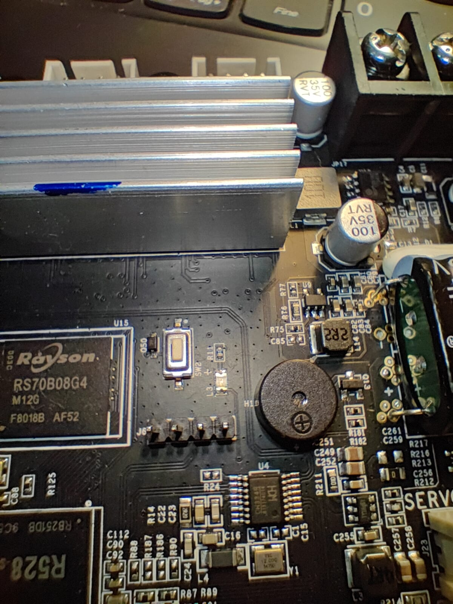
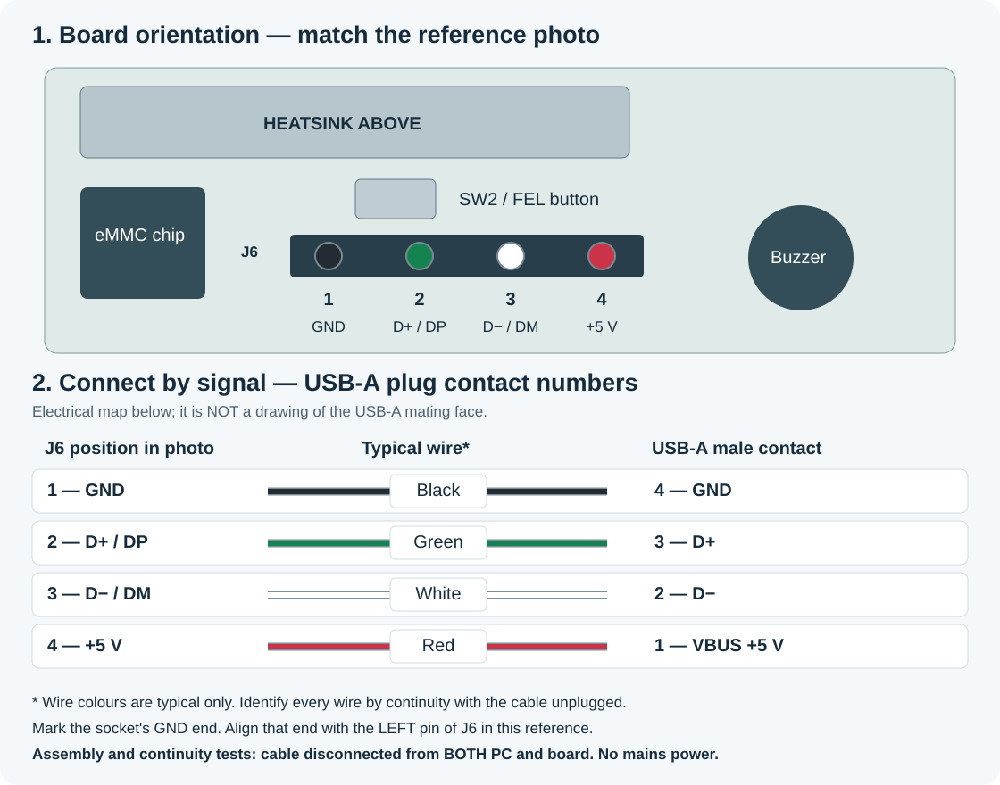

# CC2 Assist: backup, cleanup and FEL recovery beta

[Project homepage](../README.md) · [Download CC2 Assist 0.7.0 beta](https://github.com/Neme77/centauri-carbon-2-community/releases/download/CC2-Control-1.2.30-V4.4.4-Universal/CC2-Assist-0.7.0-FEL-Beta-r2.zip) · [ZIP checksum](https://github.com/Neme77/centauri-carbon-2-community/releases/download/CC2-Control-1.2.30-V4.4.4-Universal/CC2-Assist-0.7.0-FEL-Beta-r2.zip.sha256.txt)

Windows · English / Italiano · **Centauri Carbon 2 only**.
Extract the entire ZIP and open **CC2-Assist.exe**. Python, WSL, XFEL and
firmware downloads are not required separately: the app includes XFEL and
its original-base **02.01.01.13 + SSH** recovery images. The appropriate
Windows FEL USB driver must already be configured; if identification fails,
keep the report and ask for setup help before continuing.

## Choose the right workflow

| Situation | Use |
| --- | --- |
| Printer works and you want a backup | **SSH & backup**, using the printer IP and root SSH password. |
| Remove reviewed obsolete archives | Back up and verify the recognised archives on the PC, then use the app's cleanup action. Active components, RFID and calibrations are protected by this workflow. |
| Printer firmware needs recovery | **FEL collection**, then **FEL recovery**, following the steps below. |
| Working printer, testing compatibility only | Complete the read-only FEL checks and stop before **Factory recovery**. |

**SSH cleanup and factory recovery are different operations.** Factory recovery
resets the shared overlay and user settings, including Wi-Fi, G-code and
calibrations. It is designed to preserve the identity partition and RFID files;
this preservation has offline validation, but the complete new reset on a board
containing real user data remains a beta trial. It does not program the Canvas
MCU. Back up anything you need over SSH first if the printer is accessible.

## 1. Make and check the USB FEL cable

Use a **USB-A male data cable** and four insulated female contacts in a compatible
1×4 housing, or suitable individual female sockets. Check the actual header's
pitch and fit. A USB-to-TTL/UART adapter is not used for this connection.

### Identify the board connector

Keep the reference photo upright: **heatsink above, buzzer to the right**.
The four-pin **J6** header is below the **SW2 / FEL** button.

Photo: Neme77. It illustrates the previously tested board layout; it does not
establish the pinout of an unknown revision.

### Electrical connections and orientation

| J6, left to right in the upright photo | USB-A male electrical contact | Typical colour only |
| --- | --- | --- |
| 1 — GND | 4 — GND | Black |
| 2 — DP / D+ | 3 — D+ | Green |
| 3 — DM / D− | 2 — D− | White |
| 4 — +5 V | 1 — VBUS +5 V | Red |

USB contact numbers identify electrical contacts, **not left/right positions
on a drawing of the plug face**. Front/rear and plug/socket views can be mirrored.
Check the plug manufacturer's numbering. Do not rely on wire colours alone.

With the cable disconnected from **both PC and board**, check each of the four
paths with a continuity meter. Check for shorts between different contacts,
especially +5 V to GND or the data lines. Insulate each joint, add strain relief,
keep the exposed data-pair section short, and mark the socket's GND end.
For the full assembly checklist, open **FEL-CABLE-GUIDE-EN.html** from the
extracted ZIP; **FEL-CABLE-ASSEMBLY-EN.txt** is the plain-text version.

## 2. Connect in FEL and collect the BEFORE reports

1. Disconnect printer mains power. With the PC USB unplugged, fit the cable to
   J6 and recheck orientation. In this procedure the board uses **PC USB power
   only**. Never combine PC USB +5 V and printer mains power.
2. Hold **SW2 / FEL**, connect USB to the PC, then release the button. Do not
   run motors, heaters or a print from USB power. Close other FEL/XFEL tools.
3. Open CC2 Assist and select **English** at the bottom. Set **Save on PC**
   to a new empty folder for this board and attempt. Use the same folder for
   **Reports on PC** in **FEL collection**.
4. Turn off **Simulate FEL offline**, confirm the FEL setup and click
   **Identify board**. The tested identification starts with
   `AWUSBFEX ID=0x00185900(R528/T113)`.
5. Click **Collect boot environments & A headers**. Wait for
   `FEL_READ_ONLY_COLLECTION_COMPLETE`. Keep the entire `fel-capture-...`
   folder and its private ZIP.

These checks read eMMC and temporarily use SRAM; they do not write eMMC or
select a boot slot. Demo/simulation mode does not test the connected board.
Use separate report folders for different boards. Do not share raw captures
or backups publicly.

## 3. Prepare the board-specific kit and check it

1. In **FEL recovery**, select the full **fel-capture-... folder containing
   result.json**. Do not select its private ZIP or an inner emmc-header folder.
2. Click **Prepare kit from collection**. The app fills in the generated kit;
   you do not need to find or select a separate firmware file.
3. Click **Check before writing**. Continue only after
   `GENERIC_FEL_READ_ONLY_PASSED`. Preserve the report. The check expires after
   ten minutes; run a fresh check if you wait longer before writing.
4. **For a read-only compatibility test, stop here.** Send the BEFORE reports
   privately. Do not reset a working printer just to test recovery.

The kit checks this board's identity, both boot environments and admitted
geometry. The two measured capacities are **15,269,888** and **15,307,776 sectors**.
A matching capacity alone does not prove another board revision is supported.
Never bypass a refusal by editing a manifest or using someone else's kit.

## 4. Factory recovery — only when recovery is needed

1. Read what will be reset above. Confirm the printer model in the app.
2. Keep USB-only power connected. Click **Factory recovery** and enter
   **RESET FACTORY** when requested.
3. Keep the PC awake, power stable and USB connected through the entire operation.
   Earlier spare-board recovery took about two hours; the full beta workflow
   may differ. Repeated progress counts can occur during readback and do not
   establish completion by themselves.
4. Wait for **FACTORY_RECOVERY_READY_FOR_MANUAL_BOOT_A**. An image-write message
   alone is not sufficient. The app writes and verifies A, selects A and
   collects fresh FEL evidence. It does not rewrite B firmware images.
5. Keep the `factory-recovery-...` report and the new `fel-capture-...` folders.
   **There is no automatic reboot. Do not run Boot A/B separately** after this
   successful factory recovery: A has already been selected.

If any step fails, preserve the whole attempt's reports and ask for help.
Do not automatically retry, force a boot switch or erase recovery records.

## 5. First boot and finish recovery

1. Only after the success message, **disconnect PC USB first**. Then reconnect
   normal mains power and boot manually. Never leave both connected together
   in this procedure.
2. Check touchscreen, firmware version and Wi-Fi; reconnect Wi-Fi on the display.
   Do not begin a print or Canvas/RFID operation during recovery checks.
3. In **SSH & backup**, turn off **Offline demo** and enter the printer IP and
   recovery image's root SSH password. Overlay reset may have removed the old
   community password. Do not include passwords in reports.
4. In **Finish recovery**, select the **factory-recovery-... folder**, not a
   fel-capture folder. Click **Verify, back up and finish**.
5. Wait for **FACTORY_RECOVERY_COMPLETE**. Retain the `factory-postboot-...`
   report and **critical.PRIVATE.tar**, the verified identity/RFID backup.
   Finishing saves and verifies that backup before deleting the old user data
   set aside on the printer; it is not a backup of discarded G-code/settings.
6. Retain the AFTER diagnostics and complete **TEST-REPORT.txt**. Follow
   **REPORTS-CHECKLIST.txt** and send the attempt's reports privately.
   Recalibrate after the factory reset before normal printing.

This restores the bundled **original .13 + SSH recovery image**, which is
modified to provide recovery/SSH; it is not the byte-identical vendor firmware
and is not Universal 07. Community firmware installation is a separate step:
confirm successful recovery and follow the [firmware installation guide](FIRMWARE_UPGRADE.md).

## Validation and support

- **Physically checked:** read-only FEL collection on both measured mainboard
  variants; earlier spare-board A write, full readback and boot to original .13 + SSH.
- **SSH cleanup:** exercised on a real printer preserving RFID, calibrations
  and active components.
- **Offline checks:** 24 application executable checks and ARM checks of the
  new overlay/user-data reset.
- **Still beta:** the complete newer factory reset on a board with populated
  user data. Earlier successful recoveries do not validate every new reset path.

For help, [open a support issue](https://github.com/Neme77/centauri-carbon-2-community/issues/new/choose)
with the app version, board/printer model, final message and failed step.
Keep raw reports private: they can contain identity data, configuration and
network information. Recovery does not repair hardware faults.

Source material: the photo and signal map included in the published app ZIP;
[OpenCentauri CC2 mainboard reference](https://docs.opencentauri.cc/hardware/CC2/mainboard/)
and [USB 2.0 specification](https://www.alsa-project.org/files/pub/manuals/usb/usb_20.pdf).
