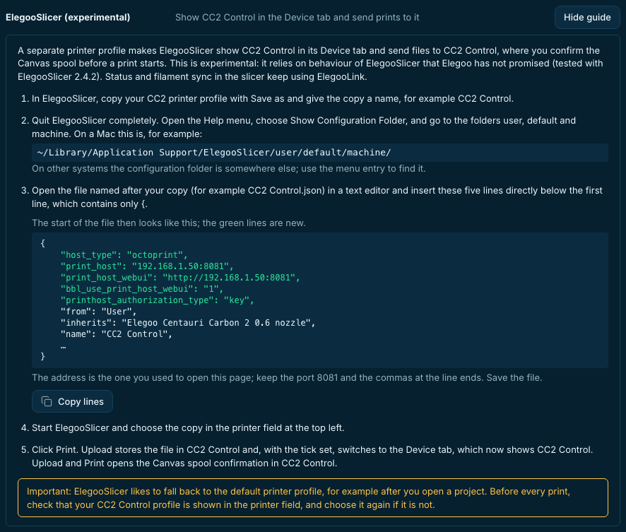
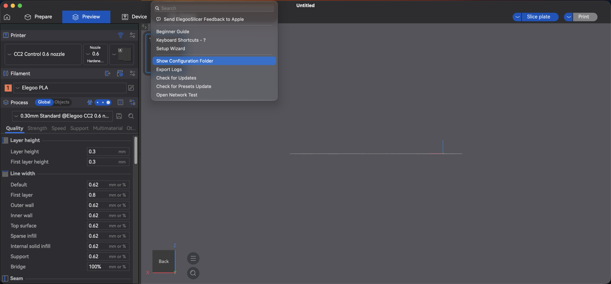
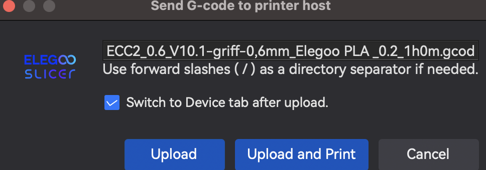
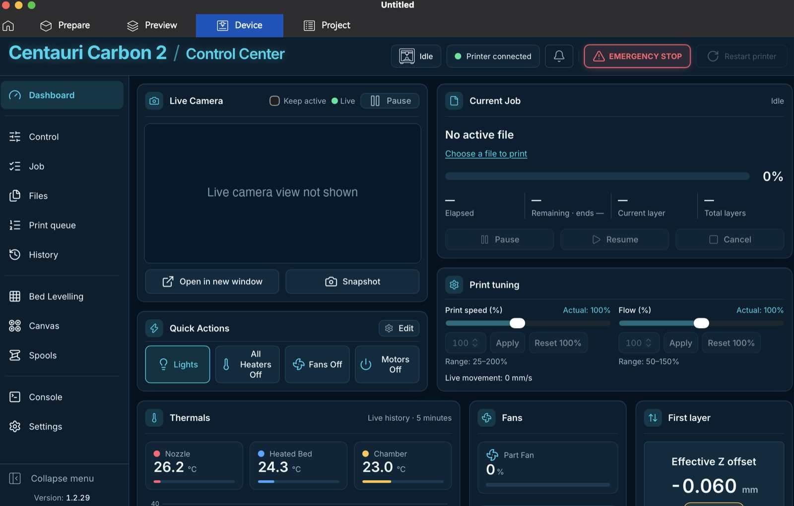
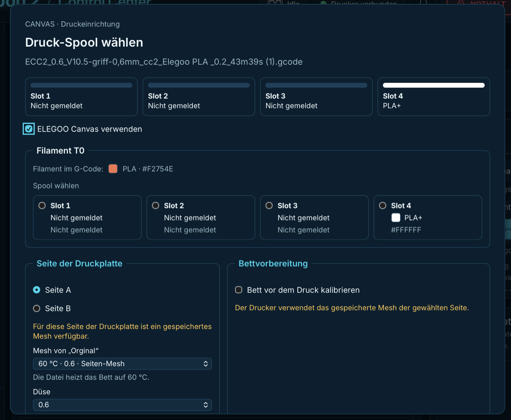

# ElegooSlicer: CC2 Control nella scheda Dispositivo (sperimentale)

[English](ELEGOOSLICER.md) · [OrcaSlicer e sync Canvas](ORCASLICER.it.md) · [Homepage](../README.md)

Questo è un modo **sperimentale** di usare ElegooSlicer con CC2 Control. Si basa su un comportamento di ElegooSlicer che Elegoo non ha garantito; è stato provato con ElegooSlicer 2.4.2 (app 1.5.3.5) su un Mac. Gli stessi passaggi compaiono in CC2 Control in **Impostazioni → Integrazioni → ElegooSlicer (sperimentale)**.



## Cosa si ottiene

Con un profilo stampante separato:

- la scheda **Dispositivo** dello slicer mostra CC2 Control invece della pagina integrata di ElegooSlicer;
- **Stampa** apre la finestra «Invia G-code all'host di stampa» e invia il file a CC2 Control;
- **Carica e stampa** apre in CC2 Control la conferma della bobina Canvas: la stampa parte solo dopo aver confermato lì slot, lato del piatto e preparazione del piano. Un nome di file già presente viene salvato come copia numerata, mai sovrascritto.

Resta come prima: stato della stampante e sincronizzazione del filamento nello slicer usano ancora la connessione ElegooLink di ElegooSlicer. Le voci stampante esistenti non cambiano. Con un altro profilo stampante torna la scheda Dispositivo integrata.

## Configurazione

1. In ElegooSlicer copia il tuo profilo stampante CC2 con **Salva con nome** e dai alla copia un nome, per esempio `CC2 Control`.
2. **Chiudi completamente ElegooSlicer.**
3. Apri il menu Aiuto dello slicer, scegli la voce **Show Configuration Folder** e vai in `user`, `default`, `machine`. Su un Mac la cartella è, per esempio:

   `~/Library/Application Support/ElegooSlicer/user/default/machine/`

   Su altri sistemi la cartella di configurazione si trova altrove; trovala con la voce di menu. (È stata verificata solo la cartella del Mac.)
4. Apri in un editor di testo il file con il nome della tua copia, per esempio `CC2 Control.json`. Inserisci queste cinque righe **subito sotto la prima riga**, che contiene solo `{`. Sostituisci `192.168.1.50` con l'indirizzo della tua stampante; mantieni la porta `8081` e la virgola a fine di ogni riga:

   ```json
   {
       "host_type": "octoprint",
       "print_host": "192.168.1.50:8081",
       "print_host_webui": "http://192.168.1.50:8081",
       "bbl_use_print_host_webui": "1",
       "printhost_authorization_type": "key",
       "from": "User",
       "inherits": "Elegoo Centauri Carbon 2 0.6 nozzle",
       "name": "CC2 Control",
       …
   }
   ```

   Le prime cinque righe tra le parentesi sono quelle nuove; quelle sotto esistono già nel file (i valori di `inherits` e `name` dipendono da ugello e nome). Salva il file.
5. Avvia ElegooSlicer e scegli la copia nel campo stampante in alto a sinistra.
6. Fai clic su **Stampa**. **Carica** salva il file in CC2 Control e, con la spunta «passa alla scheda Dispositivo dopo il caricamento», apre la scheda Dispositivo, che ora mostra CC2 Control. **Carica e stampa** apre la conferma della bobina in CC2 Control.

## Cosa si vede

Il menu Aiuto dello slicer ha la voce **Show Configuration Folder** (passo 3); il campo stampante in alto a sinistra mostra la copia del tuo profilo:



Con il profilo scelto, **Stampa** apre questa finestra:



La scheda **Dispositivo** mostra poi CC2 Control (la vista della telecamera dal vivo qui non è mostrata):



**Carica e stampa** apre in CC2 Control la conferma della bobina Canvas; la stampa parte solo dopo la conferma lì (mostrata in un CC2 Control in tedesco):



## Importante: il profilo torna a quello predefinito

ElegooSlicer torna volentieri al profilo stampante predefinito, per esempio **dopo aver aperto un progetto**. Prima di ogni stampa controlla che nel campo stampante ci sia il tuo profilo CC2 Control e, se non c'è, sceglilo di nuovo. Con un altro profilo la finestra e la scheda Dispositivo sono quelle integrate.

## Note

- Le voci in stile OctoPrint nel profilo vengono lette dal codice classico dell'host di stampa dello slicer. L'elenco stampanti di ElegooSlicer («Aggiungi stampante») offre solo la connessione ElegooLink; le voci dei tipi `octoprint` o `moonraker` lì restano offline.
- La modifica del profilo è un semplice file nella tua cartella utente; per annullarla scegli il profilo originale o elimina la copia.
- Non provati: Windows e Linux, altre versioni di ElegooSlicer e ugelli diversi da 0,6 mm (il profilo segue quello che hai copiato).
