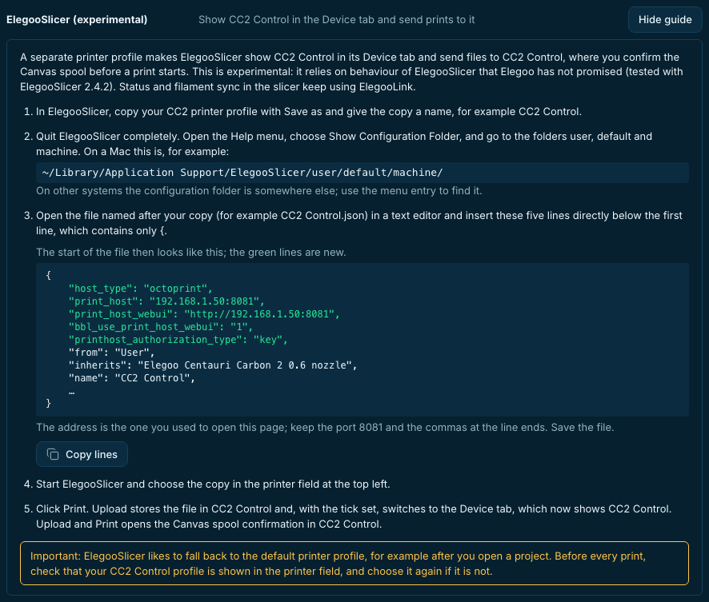
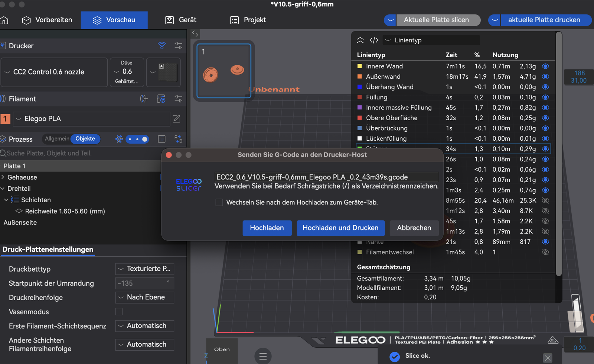
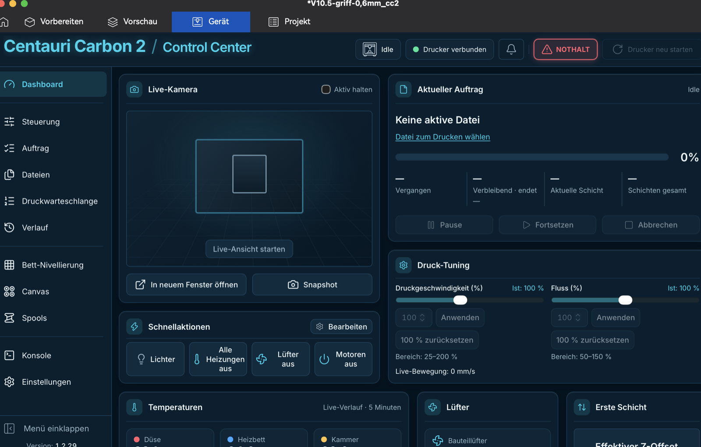
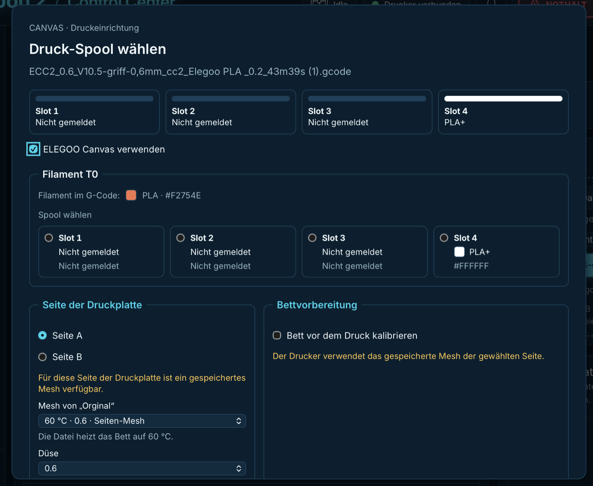

# ElegooSlicer: CC2 Control in the Device tab (experimental)

[Italiano](ELEGOOSLICER.it.md) · [OrcaSlicer and Canvas sync](ORCASLICER.md) · [Homepage](../README.md)

This is an **experimental** way to use ElegooSlicer with CC2 Control. It relies on behaviour of ElegooSlicer that Elegoo has not promised; it was tested with ElegooSlicer 2.4.2 (app 1.5.3.5) on a Mac. The same steps are shown in CC2 Control under **Settings → Integrations → ElegooSlicer (experimental)**.



## What you get

With a separate printer profile:

- the slicer's **Device** tab shows CC2 Control instead of ElegooSlicer's built-in page;
- **Print** opens the dialog “Send G-code to the printer host” and sends the file to CC2 Control;
- **Upload and Print** opens CC2 Control's Canvas spool confirmation, so the print only starts after you confirm the slot, the plate side and the bed preparation there. An existing file name is stored as a numbered copy, never overwritten.

What stays as before: printer status and filament sync inside the slicer keep using ElegooSlicer's own ElegooLink connection. Your existing printer entries are not changed. Another printer profile shows the built-in Device tab again.

## Set it up

1. In ElegooSlicer, copy your CC2 printer profile with **Save as** and give the copy a name, for example `CC2 Control`.
2. **Quit ElegooSlicer completely.**
3. Open the slicer's Help menu, choose the entry **Show Configuration Folder**, and go to `user`, `default`, `machine`. On a Mac the folder is, for example:

   `~/Library/Application Support/ElegooSlicer/user/default/machine/`

   On other systems the configuration folder is somewhere else; use the menu entry to find it. (Only the Mac folder was checked.)
4. Open the file named after your copy, for example `CC2 Control.json`, in a text editor. Insert these five lines **directly below the first line**, which contains only `{`. Replace `192.168.1.50` with your printer's address; keep the port `8081` and the comma at the end of every line:

   ```json
   {
       "host_type": "octoprint",
       "print_host": "192.168.1.50:8081",
       "print_host_webui": "http://192.168.1.50:8081",
       "bbl_use_print_host_webui": "1",
       "printhost_authorization_type": "key",
       "from": "User",
       "inherits": "Elegoo Centauri Carbon 2 0.6 nozzle",
       "name": "CC2 Control",
       …
   }
   ```

   The first five lines inside the braces are the new ones; the lines below them already exist in your file (your values for `inherits` and `name` differ with your nozzle and name). Save the file.
5. Start ElegooSlicer and choose the copy in the printer field at the top left.
6. Click **Print**. **Upload** stores the file in CC2 Control and, with the tick “switch to the Device tab after upload” set, opens the Device tab, which now shows CC2 Control. **Upload and Print** opens the spool confirmation in CC2 Control.

## What you see

With the profile chosen, **Print** opens this dialog (shown in a German ElegooSlicer); the printer field at the top left shows the profile:



The **Device** tab then shows CC2 Control:



**Upload and Print** opens the Canvas spool confirmation in CC2 Control; the print only starts after you confirm it there:



## Important: the profile falls back to the default

ElegooSlicer likes to fall back to the default printer profile, for example **after you open a project**. Before every print, check that your CC2 Control profile is shown in the printer field, and choose it again if it is not. With another profile the dialog and the Device tab are the built-in ones.

## Notes

- The OctoPrint-style entries in the profile are read by the slicer's classic printer-host code. ElegooSlicer's own printer list (“Add Printer”) offers only its ElegooLink connection; entries of the types `octoprint` or `moonraker` there stay offline.
- A profile edit is a plain file in your user folder; to undo it, choose your original profile or delete the copy.
- Not tested: Windows and Linux, other ElegooSlicer versions, and other nozzle sizes than 0.6 mm (the profile follows the profile you copied).
