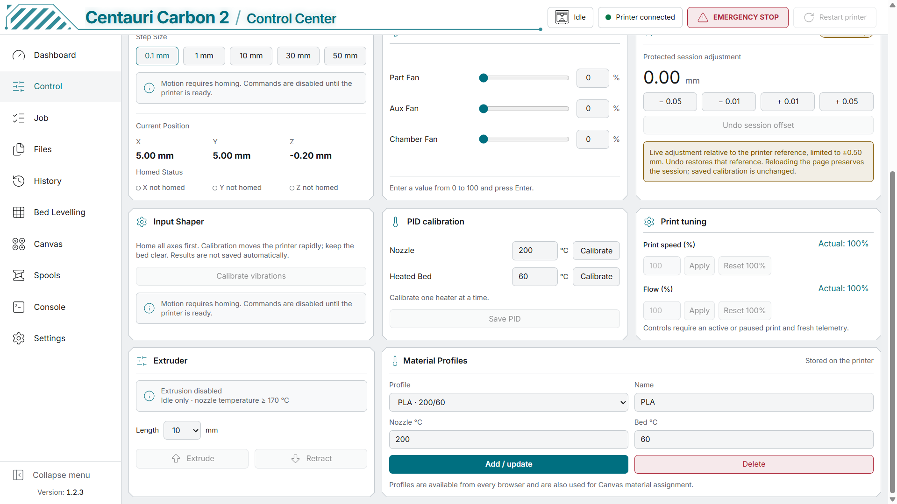
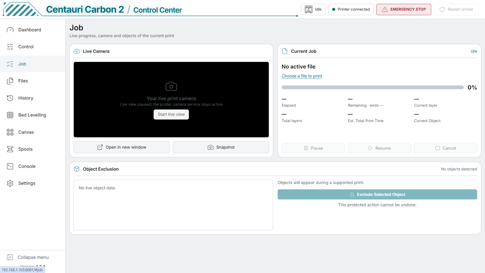
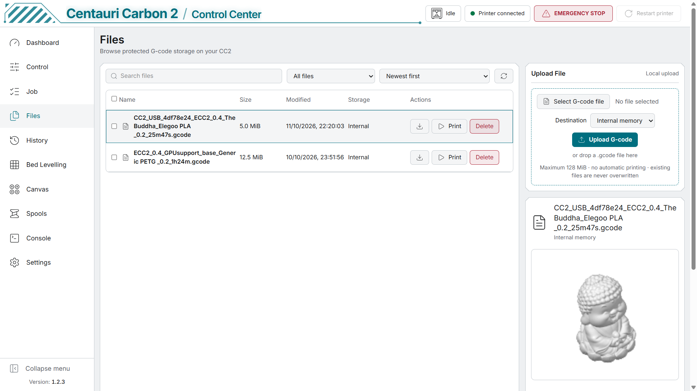
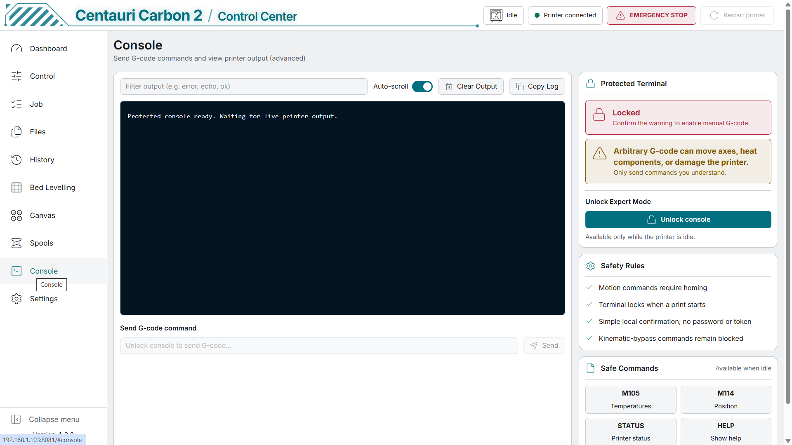
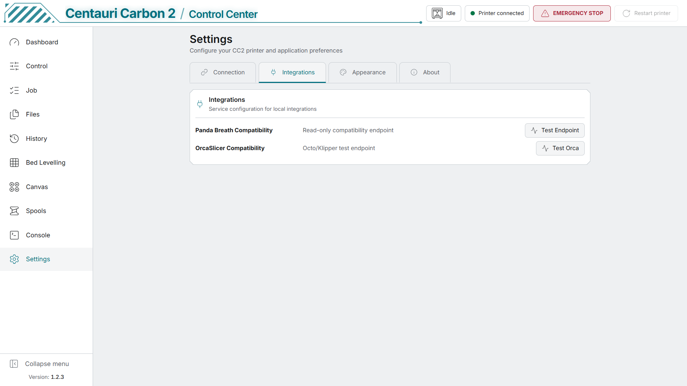
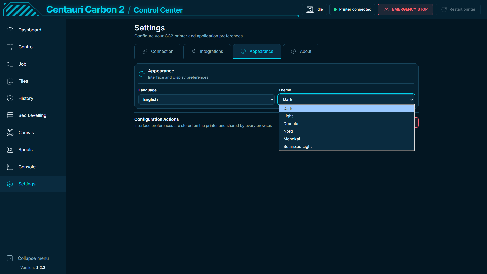

# CC2 Control screenshots

[Homepage](../README.md) · [First setup](FIRST_RUN.md) · [OrcaSlicer and Canvas sync](ORCASLICER.md)

Real-printer screenshots supplied by the maintainer on 13 October 2026, showing **CC2 Control 1.2.3** in the V4.4 release candidate. Most captures use the Light theme; the final capture shows the Dark theme. These interface screenshots are separate from the download/version status on the homepage.

## Dashboard

Live camera, Quick Actions, print status and temperature history.

## Control and temperature presets

Movement, temperature targets, lights, numeric fan controls and the preheat dropdown, including PLA MATTE.

## Calibration and material profiles

Input Shaper, PID calibration, extrusion controls and editable material profiles.

## Job

Print progress, live camera controls and object exclusion. The printer is Idle in this capture.

## File manager

Internal storage, G-code upload, protected print actions and model preview.

## Bed levelling

Interactive 3D mesh, saved profiles and measured height statistics.

## Canvas

Four filament slots, dimmed empty slots, material selection, automatic refill and Reset all filaments.

## Spool inventory

Optional spool tracking and inventory. Tracking is off in this capture.

## Protected console

Manual G-code console with Idle-only unlocking and protected commands.

## Integration settings

Compatibility checks for OrcaSlicer and the read-only Panda Breath endpoint.

## Appearance and themes

Persistent interface preferences and the six available themes.

